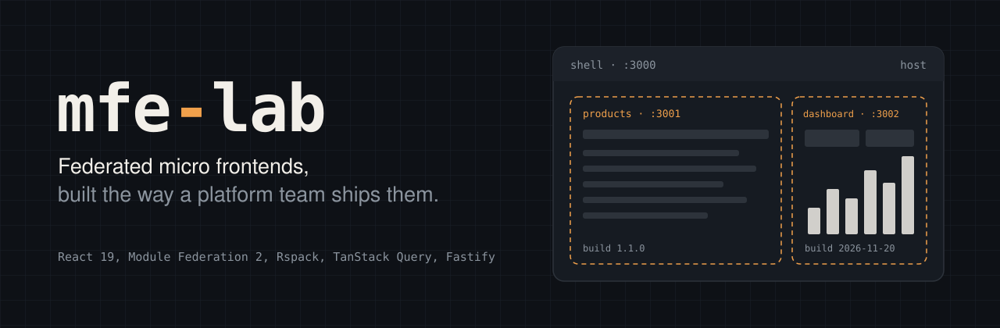
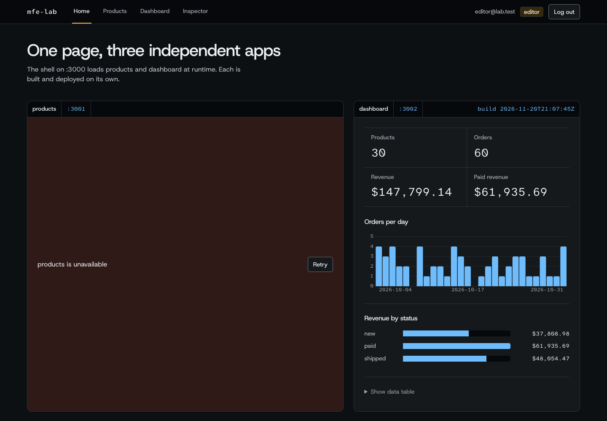
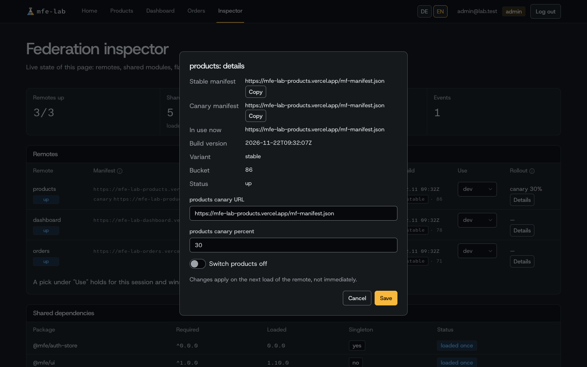
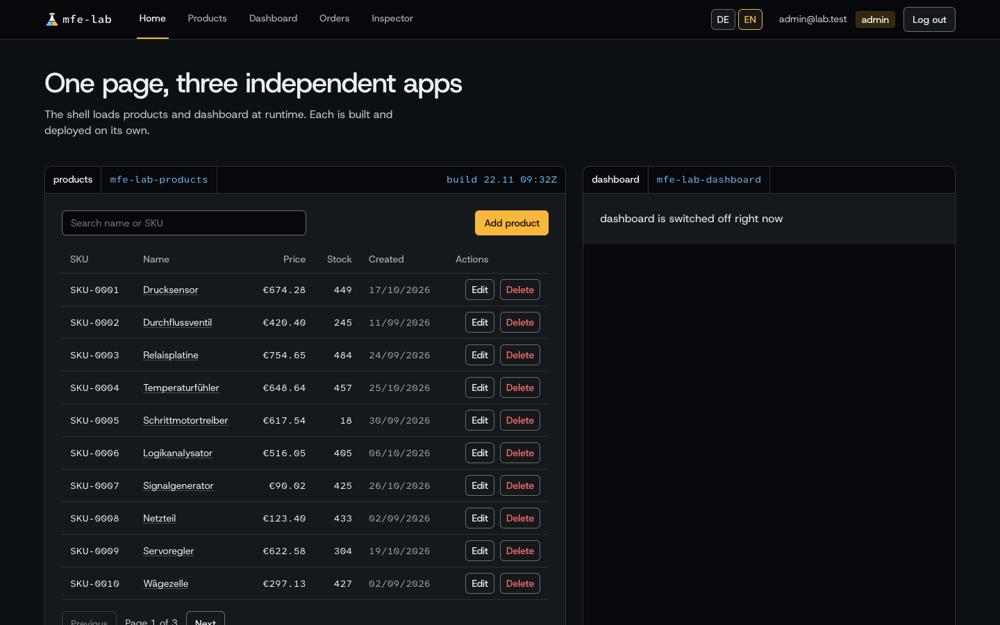
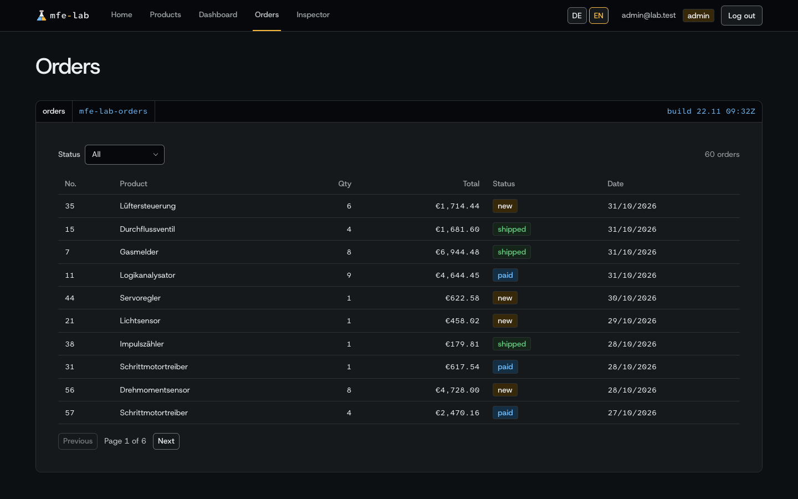

<h1 align="center">
  
</h1>

<p align="center">
  <a href="https://github.com/sotream/mfe-lab/actions/workflows/ci.yml"></a>
  <a href="https://mfe-lab.vercel.app"></a>
  
  
  
  
  
</p>

<p align="center">
  <a href="https://mfe-lab.vercel.app"><b>Live demo</b></a>&nbsp;&nbsp;&nbsp;
  <a href="docs/tour.md"><b>Tour</b></a>&nbsp;&nbsp;&nbsp;
  <a href="docs/architecture.md"><b>How it works</b></a>&nbsp;&nbsp;&nbsp;
  <a href="docs/rfc/"><b>RFCs</b></a>&nbsp;&nbsp;&nbsp;
  <a href="#quick-start"><b>Quick start</b></a>
</p>

**Live demo: <https://mfe-lab.vercel.app>**. Sign in as `admin@lab.test` / `lab12345` (demo-only; read-only on the live site), or as `editor@lab.test` / `viewer@lab.test` with the same password. A daily reset at 03:00 UTC puts back the products, orders and demo users, the remote registry (no canary, all remotes on), the feature flags and the error log. The database is on a free tier, so the first request may take a second to wake it.

One shell loads three independently built and deployed remotes (two React, one Vue 3.5) **at runtime** with Module Federation 2, on top of a small Fastify + Postgres API.

It answers the questions a real micro frontend platform runs into:

- How does auth reach a remote that never logged in?
- How do remotes stay in sync without sharing a store?
- What happens when one remote is down, or ships a new version?

Every answer is running code, covered by black-box tests and argued in a short RFC.

### Try it in 2 minutes

On the [live site](https://mfe-lab.vercel.app) the demo admin is read-only: it sees everything, and the controls that would change things for every visitor are visible but disabled, with a note. To use the canary and the kill switch yourself, run `pnpm dev`, or open a PR preview (both are unlocked).

1. Sign in as `admin@lab.test` / `lab12345` (demo-only). Home shows the products and dashboard frames, each labelled with its remote name and build stamp.
2. Open **Inspector**, then **Details** on the `products` row. Look at the canary form (URL and percent): on the live site it is disabled. Unlocked, set `products canary URL` to `https://mfe-lab-products.vercel.app/mf-manifest.json` and the percent to `30`, then Save. The Rollout cell reads `canary 30%`; the dialog shows your bucket (0-99, below 30 means canary). ([RFC 0017](docs/rfc/0017-remote-registry-canary-and-kill-switch.md))
3. Open **Details** on `dashboard`: the `Switch dashboard off` box is the kill switch (disabled on the live site). Unlocked, tick it, Save and reload; sign in again and look at Home: the dashboard frame says "switched off right now" and the products table keeps working.
4. Open **Orders**. It is a Vue 3.5 remote. In DevTools, the frame body is a `#shadow-root (open)`, and `document.head` has no orders styles. ([RFC 0016](docs/rfc/0016-framework-agnostic-remotes-and-css-isolation.md))
5. Click **DE**. Every remote switches language without a reload, and prices and dates follow German formats. ([RFC 0012](docs/rfc/0012-locale-across-remotes.md))

Unlocked runs: untick the dashboard switch, set the products canary percent back to `0` and clear the URL when you are done.


## What it shows

- **Runtime composition.** The shell fetches each remote's `mf-manifest.json` at runtime. React, React Router and the auth store are shared singletons, loaded once. ([RFC 0001](docs/rfc/0001-module-federation-for-frontend.md), [0002](docs/rfc/0002-sharing-auth-state.md))
- **Failure isolation.** A dead remote shows a fallback with Retry, and the rest of the page keeps working.
- **Independent releases.** Freeze a remote into a release and switch versions in the browser without rebuilding the shell. ([RFC 0004](docs/rfc/0004-versioned-remotes.md))
- **Data between remotes.** Each remote owns its TanStack Query cache, and products keeps its UI state in a local Redux Toolkit store. They sync only through a typed event contract. ([RFC 0006](docs/rfc/0006-data-between-remotes.md))
- **Nested routing.** The shell mounts `/products/*`, and the remote owns everything below it. ([RFC 0007](docs/rfc/0007-routing-inside-remotes.md))
- **Versioned design system.** `@mfe/ui` is shared as a non-singleton with a semver range. Compatible versions dedupe, and majors live side by side. ([RFC 0008](docs/rfc/0008-design-system-versioning.md))
- **Feature flags.** Flags are served by the API and toggled live. Each remote reads only its own. ([RFC 0009](docs/rfc/0009-feature-flags.md))
- **Error tracking per remote.** Errors are attributed to the remote and build that threw them. ([RFC 0010](docs/rfc/0010-error-tracking.md))
- **Accessibility across remotes.** One owner per concern: the shell owns title, focus and the live region, remotes announce through a typed event, and lint and axe guard it. ([RFC 0011](docs/rfc/0011-accessibility-across-remotes.md))
- **Locale across remotes.** German by default for German browsers, with an EN switch. The shell owns the language (`<html lang>` plus an event), each remote owns its strings, and `Intl` formats prices, dates and times. ([RFC 0012](docs/rfc/0012-locale-across-remotes.md))
- **Remote registry, canary and kill switch.** The API keeps a registry of remotes. An admin can send a percentage of users to a canary manifest, or switch a remote off, without redeploying the shell; a canary that fails to load falls back to stable. ([RFC 0017](docs/rfc/0017-remote-registry-canary-and-kill-switch.md))
- **Mixed frameworks and CSS isolation.** The `orders` remote is Vue 3.5. The shell mounts it through a framework-agnostic `mount(el, ctx)` contract, and it renders in a Shadow DOM, so the lab's global CSS cannot reach it. The React remotes follow a checked class-prefix rule. ([RFC 0016](docs/rfc/0016-framework-agnostic-remotes-and-css-isolation.md))
- **PR previews.** Every same-repo PR gets its own live stack (shell, the remotes it changed, an API on a copy-on-write Neon branch of the data) and one sticky comment with the links. Closing the PR deletes it all. See [#65](https://github.com/sotream/mfe-lab/pull/65) for the first one, and [RFC 0018](docs/rfc/0018-pr-previews-with-a-database-branch.md).
- **Prefetch on idle.** Measured first: −31.5% median time to the first product row on Fast 4G. ([RFC 0005](docs/rfc/0005-prefetch-remotes.md))
- **Performance budgets.** Gzipped bundle size is gated in CI (shell initial JS 33.4 KB of 37 KB, products 64.8 KB of 71 KB, dashboard 51.1 KB of 56 KB, orders 66.9 KB of 72 KB); lab LCP, CLS and time-to-remotes are checked on the live site after each deploy (LCP median 1.8 s on Fast 4G). ([RFC 0015](docs/rfc/0015-performance-budgets.md))
- **An inspector page.** It shows remotes, versions, shared dependencies, flags, errors and a live event log.

| Products and dashboard, one page                        | One remote down                                                               | Live event log                                         |
| ------------------------------------------------------- | ----------------------------------------------------------------------------- | ------------------------------------------------------ |
|  |  |  |

| Remote details and canary (admin)                                                     | Dashboard switched off                                                               | Orders, Vue in a Shadow DOM                                             |
| ------------------------------------------------------------------------------------- | ------------------------------------------------------------------------------------ | ----------------------------------------------------------------------- |
|  |  |  |

The [tour](docs/tour.md) walks through every feature with screenshots and hands-on steps.

## Quick start

Node 26 (`nvm use`) and pnpm 12.

```bash
pnpm i
pnpm seed
pnpm dev     # shell :3000, products :3001, dashboard :3002, orders :3003, api :4000
```

Open <http://localhost:3000> and sign in as `admin@lab.test`, `editor@lab.test` or `viewer@lab.test`. All three use the password `lab12345`; these are demo-only credentials. Each remote also runs standalone on its own port.

```bash
pnpm lint && pnpm typecheck && pnpm test   # Vitest, black-box unit and component tests
pnpm exec playwright install chromium      # once
pnpm e2e                                   # Playwright against the dev servers
pnpm build                                 # apps/*/dist, remotes emit mf-manifest.json
```

To run the stack in Docker:

```bash
docker compose up --build -d   # shell :3000, products :3001, dashboard :3002, orders :3003
docker compose down -v         # stop and drop the DB volume
```

## Stack

React 19 (and Vue 3.5 for one remote), Rspack 2, `@module-federation/enhanced` 2, React Router, TanStack Query, Redux Toolkit, plain CSS. Fastify, Postgres (Neon-ready; PGlite for dev and tests), zod, JWT. Vitest, Testing Library, Playwright. TypeScript in strict mode and ESM throughout, as a pnpm workspace.

```
apps/shell       host: routing, login, inspector
apps/products    remote: product list, detail, CRUD
apps/dashboard   remote: stats and charts
apps/orders      remote: orders table, Vue 3.5 in a Shadow DOM
apps/api         Fastify + Postgres
packages/        auth-store, api-client, events, ui, telemetry
```

## Docs

- [How it works](docs/architecture.md): the loading sequence, data flow and state ownership, with diagrams.
- [Tour](docs/tour.md): screenshots and walkthroughs.
- [API](docs/api.md): auth, endpoints and OpenAPI.
- [Build, test, run](docs/testing.md): the test layers, e2e against Docker, act, and build-time manifest URLs.
- [Brief](docs/BRIEF.md) and [plan](docs/PLAN.md): the task list, with each task's done criteria.
- RFCs, one per decision:

| #    | RFC                                                                                                           | Decision                                                                                                                                             |
| ---- | ------------------------------------------------------------------------------------------------------------- | ---------------------------------------------------------------------------------------------------------------------------------------------------- |
| 0001 | [Module Federation for the frontend](docs/rfc/0001-module-federation-for-frontend.md)                         | One shell host and independently built remotes, joined at runtime with Rspack and `@module-federation/enhanced`.                                     |
| 0002 | [Sharing auth state](docs/rfc/0002-sharing-auth-state.md)                                                     | The shell owns login; remotes read user and token from the `@mfe/auth-store` singleton; the token stays in memory.                                   |
| 0003 | [Native Federation comparison](docs/rfc/0003-native-federation-comparison.md)                                 | Stay on Module Federation 2; Native Federation would replace working code for little gain.                                                           |
| 0004 | [Versioned remotes](docs/rfc/0004-versioned-remotes.md)                                                       | Freeze a remote into a static release; the shell switches versions by changing only the manifest URL.                                                |
| 0005 | [Prefetch remotes on idle](docs/rfc/0005-prefetch-remotes.md)                                                 | After first render the shell preloads the remotes on idle; measured 1201 to 823 ms on Fast 4G.                                                       |
| 0006 | [Data between remotes](docs/rfc/0006-data-between-remotes.md)                                                 | One TanStack Query client per remote, Redux Toolkit local to products, typed `window` events between remotes; nothing shared.                        |
| 0007 | [Routing inside remotes](docs/rfc/0007-routing-inside-remotes.md)                                             | The shell mounts a remote at `<name>/*`; the remote owns the subtree with relative links, on the shared router.                                      |
| 0008 | [Design system versioning](docs/rfc/0008-design-system-versioning.md)                                         | `@mfe/ui` is a non-singleton semver share; CSS carries a major prefix (`ds1-`), so two versions can coexist.                                         |
| 0009 | [Feature flags](docs/rfc/0009-feature-flags.md)                                                               | Flags live in the API; each remote reads them with its own query client; `flags:changed` refreshes them without a reload.                            |
| 0010 | [Error tracking per remote](docs/rfc/0010-error-tracking.md)                                                  | Frames and `window` handlers report to the API with remote and build; admins read them in the inspector.                                             |
| 0011 | [Accessibility across remotes](docs/rfc/0011-accessibility-across-remotes.md)                                 | The shell owns title, focus, skip link, `h1` and the live region; remotes own their subtree and announce through an event.                           |
| 0012 | [Locale across remotes](docs/rfc/0012-locale-across-remotes.md)                                               | The shell owns the language (`<html lang>` plus `locale:changed`); each app translates its own strings; `Intl` formats money and dates.              |
| 0013 | [Postgres for the API](docs/rfc/0013-postgres-for-the-api.md)                                                 | Postgres everywhere: Neon over TCP in production, PGlite (Postgres in WASM) in dev and tests, selected by `DATABASE_URL`.                            |
| 0014 | [Typed federation contract](docs/rfc/0014-typed-federation-contract.md)                                       | What each remote exposes lives in one file; a wrong module name fails `pnpm typecheck`.                                                              |
| 0015 | [Performance budgets](docs/rfc/0015-performance-budgets.md)                                                   | Gzipped size is gated in CI, Web Vitals are measured on the live site after each deploy; budgets live in `perf-budget.json`.                         |
| 0016 | [Framework-agnostic remotes and CSS isolation](docs/rfc/0016-framework-agnostic-remotes-and-css-isolation.md) | A `mount(el, ctx)` contract lets a Vue remote render in a Shadow DOM; React remotes follow a checked class-prefix rule.                              |
| 0017 | [Remote registry, canary and kill switch](docs/rfc/0017-remote-registry-canary-and-kill-switch.md)            | The API holds a canary URL, a percentage and an off switch per remote; the shell decides per user at boot, and a failed canary falls back to stable. |
| 0018 | [PR previews with a database branch](docs/rfc/0018-pr-previews-with-a-database-branch.md)                     | Each PR gets a public stack and an API on its own Neon branch, with a sticky comment; closing the PR deletes it all.                                 |

## Deliberately not done

Choices the lab leaves out on purpose, each with the RFC that records it.

- **Server-side rendering or streaming of remotes.** Not yet, on purpose. Client-side composition is the subject of the lab, and the brief rules out SSR and Next.js ([BRIEF](docs/BRIEF.md), [RFC 0001](docs/rfc/0001-module-federation-for-frontend.md), [RFC 0016](docs/rfc/0016-framework-agnostic-remotes-and-css-isolation.md) and [RFC 0017](docs/rfc/0017-remote-registry-canary-and-kill-switch.md) as non-goals). Composing on the server would add a Node build per remote, and the Vercel function loader already rejects ESM-only dependencies loaded through `require()` ([deploy notes](docs/deploy.md)). [RFC 0003](docs/rfc/0003-native-federation-comparison.md) notes that Module Federation's own SSR support is still listed as planned. This changes if SEO or first paint for anonymous pages becomes a goal.
- **A shared store or cache across remotes.** Each remote owns its TanStack Query client, and they talk through typed events. A global store or shared query client would couple the releases that micro frontends exist to decouple ([RFC 0006](docs/rfc/0006-data-between-remotes.md), [RFC 0012](docs/rfc/0012-locale-across-remotes.md)).
- **Native Federation instead of Module Federation 2.** It would replace working Rspack, manifest, inspector and test code for little gain. [RFC 0003](docs/rfc/0003-native-federation-comparison.md) lists what would reopen it, such as dropping Rspack, consuming remotes from non-JS hosts, or a blocking MF2 bug.
- **Iframes for isolation.** No shared token, layout or deps, and poor accessibility ([RFC 0001](docs/rfc/0001-module-federation-for-frontend.md), [RFC 0016](docs/rfc/0016-framework-agnostic-remotes-and-css-isolation.md)). Shadow DOM for the Vue remote and a prefix rule for the React ones give enough isolation.

- **Keeping the session across a reload.** The access token lives only in memory, so a page reload signs you out. A stored token (localStorage or a JS-readable cookie) is what an XSS would steal, and [RFC 0002](docs/rfc/0002-sharing-auth-state.md) rejects localStorage for that reason. An HttpOnly refresh cookie with rotation would fix the reload, but a demo does not need it, and the RFC lists refresh tokens and cookie sessions as non-goals. This changes if real users with long sessions appear.

## How it was built

Each task in [`docs/PLAN.md`](docs/PLAN.md) goes through its own PR. A builder writes the code. A tester writes black-box tests from the task's contract without reading the implementation. CI runs lint, typecheck, unit and e2e tests on every PR, and [act](https://github.com/nektos/act) reproduces it locally. Dependabot opens weekly grouped updates, and minor and patch ones merge automatically once CI is green.

## Author

Built by Andrii Prisniak ([@sotream](https://github.com/sotream)).

## License

[MIT](LICENSE).
