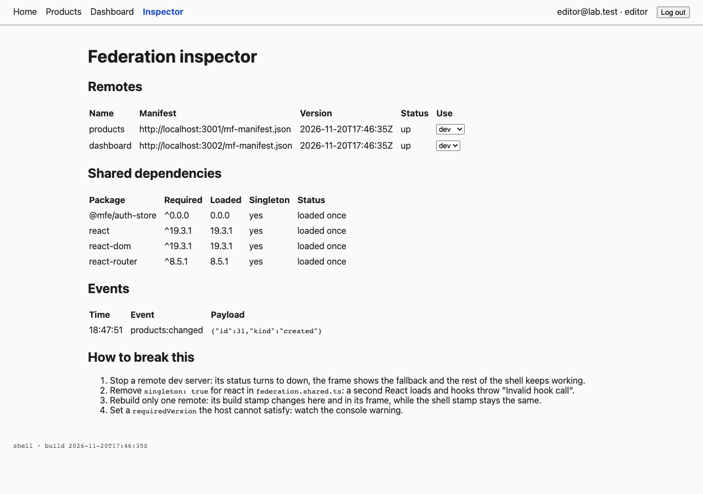

<h1 align="center">
  
</h1>

<p align="center">
  <a href="https://github.com/sotream/mfe-lab/actions/workflows/ci.yml"></a>
  
  
  
  
  
</p>

<p align="center">
  <a href="docs/tour.md"><b>Tour</b></a>&nbsp;&nbsp;&nbsp;
  <a href="docs/architecture.md"><b>How it works</b></a>&nbsp;&nbsp;&nbsp;
  <a href="docs/rfc/"><b>RFCs</b></a>&nbsp;&nbsp;&nbsp;
  <a href="#quick-start"><b>Quick start</b></a>
</p>

One shell loads two independently built and deployed React remotes **at runtime** with Module Federation 2, on top of a small Fastify + SQLite API.

It answers the questions a real micro frontend platform runs into:

- How does auth reach a remote that never logged in?
- How do remotes stay in sync without sharing a store?
- What happens when one remote is down, or ships a new version?

Every answer is running code, covered by black-box tests and argued in a short RFC.


## What it shows

- **Runtime composition.** The shell fetches each remote's `mf-manifest.json` at runtime. React, React Router and the auth store are shared singletons, loaded once. ([RFC 0001](docs/rfc/0001-module-federation-for-frontend.md), [0002](docs/rfc/0002-sharing-auth-state.md))
- **Failure isolation.** A dead remote shows a fallback with Retry, and the rest of the page keeps working.
- **Independent releases.** Freeze a remote into a release and switch versions in the browser without rebuilding the shell. ([RFC 0004](docs/rfc/0004-versioned-remotes.md))
- **Data between remotes.** Each remote owns its TanStack Query cache, and products keeps its UI state in a local Redux Toolkit store. They sync only through a typed event contract. ([RFC 0006](docs/rfc/0006-data-between-remotes.md))
- **Nested routing.** The shell mounts `/products/*`, and the remote owns everything below it. ([RFC 0007](docs/rfc/0007-routing-inside-remotes.md))
- **Versioned design system.** `@mfe/ui` is shared as a non-singleton with a semver range. Compatible versions dedupe, and majors live side by side. ([RFC 0008](docs/rfc/0008-design-system-versioning.md))
- **Feature flags.** Flags are served by the API and toggled live. Each remote reads only its own. ([RFC 0009](docs/rfc/0009-feature-flags.md))
- **Error tracking per remote.** Errors are attributed to the remote and build that threw them. ([RFC 0010](docs/rfc/0010-error-tracking.md))
- **Accessibility across remotes.** One owner per concern: the shell owns title, focus and the live region, remotes announce through a typed event, and lint and axe guard it. ([RFC 0011](docs/rfc/0011-accessibility-across-remotes.md))
- **Prefetch on idle.** Measured first: −31.5% median time to the first product row on Fast 4G. ([RFC 0005](docs/rfc/0005-prefetch-remotes.md))
- **An inspector page.** It shows remotes, versions, shared dependencies, flags, errors and a live event log.

| Two remotes, one page                                   | One remote down                                                               | Live event log                                         |
| ------------------------------------------------------- | ----------------------------------------------------------------------------- | ------------------------------------------------------ |
|  |  |  |

The [tour](docs/tour.md) walks through every feature with screenshots and hands-on steps.

## Quick start

Node 26 (`nvm use`) and pnpm 12.

```bash
pnpm i
pnpm seed
pnpm dev     # shell :3000, products :3001, dashboard :3002, api :4000
```

Open <http://localhost:3000> and sign in as `admin@lab.test`, `editor@lab.test` or `viewer@lab.test`. All three use the password `lab12345`; these are demo-only credentials. Each remote also runs standalone on its own port.

```bash
pnpm lint && pnpm typecheck && pnpm test   # Vitest, black-box unit and component tests
pnpm exec playwright install chromium      # once
pnpm e2e                                   # Playwright against the dev servers
pnpm build                                 # apps/*/dist, remotes emit mf-manifest.json
```

To run the stack in Docker:

```bash
docker compose up --build -d   # shell :3000, products :3001, dashboard :3002
docker compose down -v         # stop and drop the DB volume
```

## Stack

React 19, Rspack 2, `@module-federation/enhanced` 2, React Router, TanStack Query, Redux Toolkit, plain CSS. Fastify, better-sqlite3, zod, JWT. Vitest, Testing Library, Playwright. TypeScript in strict mode and ESM throughout, as a pnpm workspace.

```
apps/shell       host: routing, login, inspector
apps/products    remote: product list, detail, CRUD
apps/dashboard   remote: stats and charts
apps/api         Fastify + SQLite
packages/        auth-store, api-client, events, ui, telemetry
```

## Docs

- [How it works](docs/architecture.md): the loading sequence, data flow and state ownership, with diagrams.
- [Tour](docs/tour.md): screenshots and walkthroughs.
- [API](docs/api.md): auth, endpoints and OpenAPI.
- [Build, test, run](docs/testing.md): the test layers, e2e against Docker, act, and build-time manifest URLs.
- [Brief](docs/BRIEF.md) and [plan](docs/PLAN.md): the task list, with each task's done criteria.
- RFCs, one per decision:

| #    | RFC                                                                                   | Decision                                                                                                                         |
| ---- | ------------------------------------------------------------------------------------- | -------------------------------------------------------------------------------------------------------------------------------- |
| 0001 | [Module Federation for the frontend](docs/rfc/0001-module-federation-for-frontend.md) | One shell host and two remotes, built and served independently, joined at runtime with Rspack and `@module-federation/enhanced`. |
| 0002 | [Sharing auth state](docs/rfc/0002-sharing-auth-state.md)                             | The shell owns login; remotes read user and token from the `@mfe/auth-store` singleton; the token stays in memory.               |
| 0003 | [Native Federation comparison](docs/rfc/0003-native-federation-comparison.md)         | Stay on Module Federation 2; Native Federation would replace working code for little gain.                                       |
| 0004 | [Versioned remotes](docs/rfc/0004-versioned-remotes.md)                               | Freeze a remote into a static release; the shell switches versions by changing only the manifest URL.                            |
| 0005 | [Prefetch remotes on idle](docs/rfc/0005-prefetch-remotes.md)                         | After first render the shell preloads both remotes on idle; measured 1201 to 823 ms on Fast 4G.                                  |
| 0006 | [Data between remotes](docs/rfc/0006-data-between-remotes.md)                         | One TanStack Query client per remote, Redux Toolkit local to products, typed `window` events between remotes; nothing shared.    |
| 0007 | [Routing inside remotes](docs/rfc/0007-routing-inside-remotes.md)                     | The shell mounts a remote at `<name>/*`; the remote owns the subtree with relative links, on the shared router.                  |
| 0008 | [Design system versioning](docs/rfc/0008-design-system-versioning.md)                 | `@mfe/ui` is a non-singleton semver share; CSS carries a major prefix (`ds1-`), so two versions can coexist.                     |
| 0009 | [Feature flags](docs/rfc/0009-feature-flags.md)                                       | Flags live in the API; each remote reads them with its own query client; `flags:changed` refreshes them without a reload.        |
| 0010 | [Error tracking per remote](docs/rfc/0010-error-tracking.md)                          | Frames and `window` handlers report to the API with remote and build; admins read them in the inspector.                         |
| 0011 | [Accessibility across remotes](docs/rfc/0011-accessibility-across-remotes.md)         | The shell owns title, focus, skip link, `h1` and the live region; remotes own their subtree and announce through an event.       |

## How it was built

Each task in [`docs/PLAN.md`](docs/PLAN.md) goes through its own PR. A builder writes the code. A tester writes black-box tests from the task's contract without reading the implementation. CI runs lint, typecheck, unit and e2e tests on every PR, and [act](https://github.com/nektos/act) reproduces it locally. Dependabot opens weekly grouped updates, and minor and patch ones merge automatically once CI is green.

## Author

Built by Andrii Prisniak ([@sotream](https://github.com/sotream)).

## License

[MIT](LICENSE).
