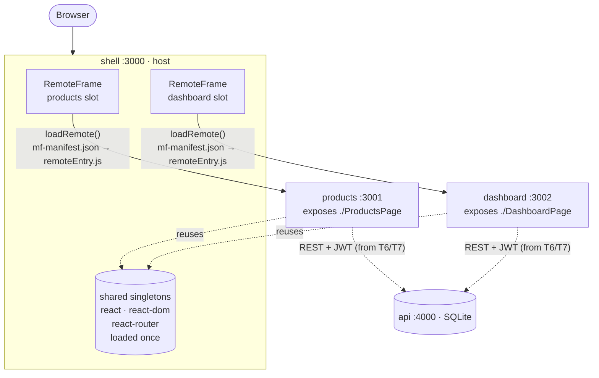

# mfe-lab

Private learning lab: **Federated Micro Frontends** with React, Rspack Module Federation, and a small Fastify + SQLite API.

Status: planned, not built yet. Start with [`docs/BRIEF.md`](docs/BRIEF.md), then [`docs/PLAN.md`](docs/PLAN.md). Design decisions live in [`docs/rfc/`](docs/rfc/).

Prerequisites: Node 26 (`nvm use`) and pnpm 12 (`packageManager` pins 12.21.0).

## How it works

The shell (`:3000`) is a Module Federation host. At runtime it loads two independently built and served remotes, `products` (`:3001`) and `dashboard` (`:3002`), by fetching their `mf-manifest.json`, then `remoteEntry.js`. `react`, `react-dom` and `react-router` are singletons: loaded once from the shell, and the remotes reuse that copy. Every remote slot is wrapped in `RemoteFrame` (error boundary, Suspense, labelled frame, Retry), so a dead remote shows a fallback and the rest of the page keeps working. The remotes will call the API on `:4000` from T6/T7.



Loading one remote, including the "remote down" path:


## Develop

```bash
pnpm i
pnpm seed
pnpm dev     # shell :3000, products :3001, dashboard :3002, api :4000 (all in parallel)
pnpm build   # apps/*/dist (remotes emit mf-manifest.json)
```

Remote manifest URLs are baked into the shell at build time; override with `MF_PRODUCTS_URL` / `MF_DASHBOARD_URL` (defaults `http://localhost:3001|3002/mf-manifest.json`). Package versions live in the `catalog:` of `pnpm-workspace.yaml`.

### Login flow

The shell owns login. `@mfe/auth-store` is a federation singleton (see [RFC 0002](docs/rfc/0002-sharing-auth-state.md)), so the shell and both remotes read the same user and token. Guarded routes (`/`, `/products`, `/dashboard`) redirect anonymous users to `/login?next=<path>`; after signing in you land back on the page you asked for. The nav shows `email · role` and a Log out button.

Demo accounts (**demo-only**, password `lab12345`): `admin@lab.test`, `editor@lab.test`, `viewer@lab.test`.

The token lives in memory only, so **a page reload logs you out** (accepted trade-off, RFC 0002). API calls go through `@mfe/api-client` to the relative `/api/...`; each dev server proxies `/api` to `http://localhost:4000` (prefix stripped), so there is no CORS setup.

## API

SQLite file `apps/api/data/app.db` (gitignored; override with `DB_PATH`, relative paths resolve against `apps/api/`). Migrations in `apps/api/migrations/*.sql` run on start, tracked by `PRAGMA user_version`.

```bash
pnpm seed         # seed if empty, otherwise prints "already seeded"
pnpm seed:reset   # wipe and reseed (3 users, 30 products, 60 orders)
pnpm --filter @mfe/api dev   # http://127.0.0.1:4000/health
```

Demo users (**demo-only credentials, never reuse**): `admin@lab.test`, `editor@lab.test`, `viewer@lab.test`, all with password `lab12345`. Passwords are hashed with scrypt (`node:crypto`), no extra dependency.

### Auth

- `POST /auth/login` with `{ "email", "password" }` returns `{ token, user }`. Wrong password and unknown email give the same `401 invalid_credentials`; a bad body gives `400 invalid_body`.
- `GET /auth/me` with `Authorization: Bearer <token>` returns the current user (read from the DB, so a deleted user gets `401`).
- Tokens are HS256 JWTs valid for **15 minutes**. There are no refresh tokens by design: log in again (RFC 0002).
- Routes are protected with `preHandler: app.authenticate` or `app.requireRole('admin', 'editor')` (`401 unauthorized`, `403 forbidden`).
- `JWT_SECRET` env sets the signing secret (see `.env.example`, **demo-only**). If unset outside production, the API uses an insecure dev secret and logs a warning; in production a missing secret is a startup error.

### Endpoints

All routes except `GET /health`, `POST /auth/login` and `/docs*` need `Authorization: Bearer <token>` (auth runs before validation, so no token is always `401`). Errors are always `{ "error": "<code>" }`: `invalid_body` / `invalid_query` / `invalid_params` (400), `unauthorized` (401), `forbidden` (403), `not_found` (404), `conflict` (409), `internal` (500).

| Route                                   | Roles allowed | Notes                                                                                                          |
| --------------------------------------- | ------------- | -------------------------------------------------------------------------------------------------------------- |
| `GET /products`                         | any           | `?page&limit&sort&order&q`; returns `{ items, total, page, limit }`; `q` matches name or sku, case-insensitive |
| `GET /products/:id`                     | any           |                                                                                                                |
| `POST /products`, `PATCH /products/:id` | admin, editor | duplicate sku gives `409`                                                                                      |
| `DELETE /products/:id`                  | admin, editor | `409` if the product has orders                                                                                |
| `GET /orders`                           | any           | `?page&limit&status`; newest first                                                                             |
| `POST /orders`, `PATCH /orders/:id`     | admin         | create sets status `new`; PATCH sets `status`                                                                  |
| `GET /stats`                            | any           | counts, revenue by status, orders per day (UTC)                                                                |

Pagination defaults to `page=1&limit=20` (max `limit` 100); `sort` is one of `id, sku, name, price_cents, stock, created_at`.

Interactive OpenAPI docs: <http://localhost:4000/docs> (spec at `/docs/json`; both public).

## Run CI locally

GitHub Actions minutes are unavailable, so run CI with [act](https://github.com/nektos/act) before any push or merge. Run it from a fresh clone of the committed branch (a worktree's `.git` points to a host path that does not exist in the container, and the clone tests only committed state, like real CI):

```bash
d=$(mktemp -d) && git clone -q -b <branch> "$PWD" "$d" && (cd "$d" && act pull_request -P ubuntu-latest=catthehacker/ubuntu:act-latest); rm -rf "$d"
```
