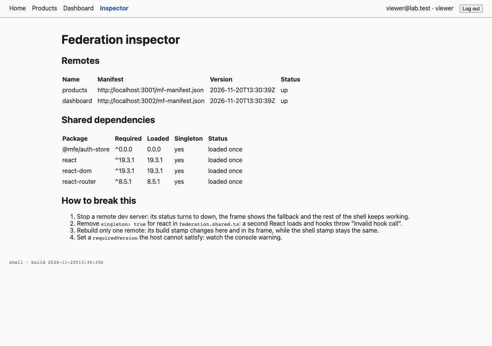
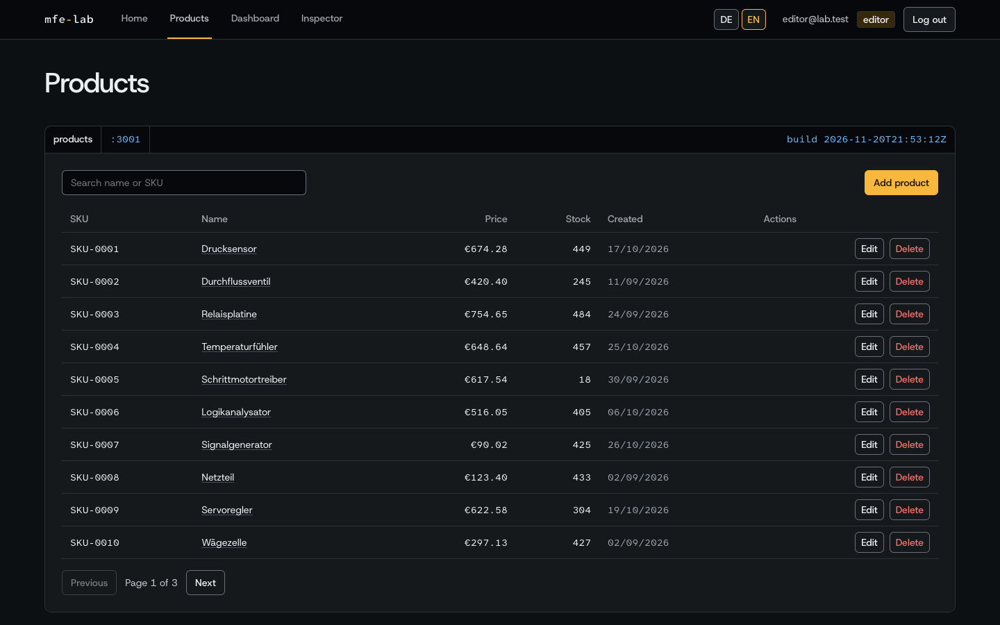
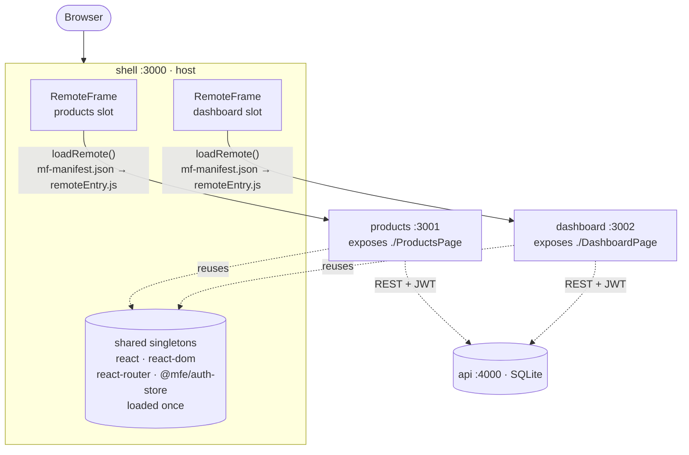
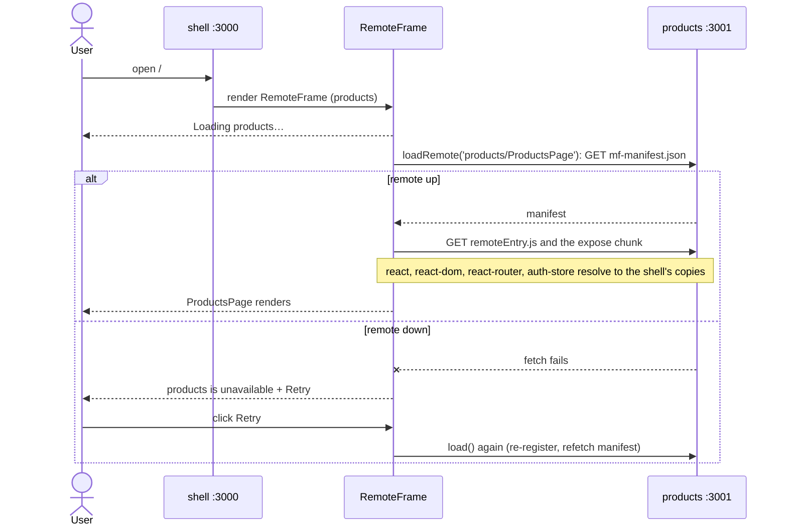

# mfe-lab

Private learning lab: **Federated Micro Frontends** with React, Rspack Module Federation, and a small Fastify + SQLite API.

The brief is in [`docs/BRIEF.md`](docs/BRIEF.md), the task plan in [`docs/PLAN.md`](docs/PLAN.md), and the design decisions in [`docs/rfc/`](docs/rfc/). Why Module Federation and not Native Federation: [RFC 0003](docs/rfc/0003-native-federation-comparison.md).

Prerequisites: Node 26 (`nvm use`) and pnpm 12 (`packageManager` pins 12.21.0).

## Quick start

```bash
pnpm i
pnpm seed
pnpm dev
```

Then open <http://localhost:3000>. `pnpm dev` runs the shell (`:3000`), products (`:3001`), dashboard (`:3002`) and the API (`:4000`) in parallel.

Demo users (**demo-only**, never reuse the password): `admin@lab.test`, `editor@lab.test`, `viewer@lab.test`, all with password `lab12345`.

## Six things to see

### 1. Login in the shell

Open the app and you are sent to `/login`. Sign in as any demo user; you land on the page you asked for. Only the shell has a login form.


### 2. Two remotes in one page

The home page mounts the products and dashboard remotes in labelled frames. Each frame shows its name, its port and the build stamp of the remote that served it. The shell footer shows its own stamp.


### 3. A dead remote does not take the page down

Stop the products dev server (or abort requests to `:3001` in the browser). The products frame shows "products is unavailable" with a Retry button, and the dashboard keeps working. Start the server again and click Retry: the frame loads without a page reload.


### 4. Remotes are built and versioned on their own

Restart or rebuild only one remote and reload the page: only its build stamp changes. The screenshot was taken after restarting just the dashboard dev server, so its stamp is newer than the products and shell stamps.


### 5. Shared dependencies are loaded once

`/inspector` (no login needed) lists the remotes with their live manifest version and up/down status, and the shared dependencies (`react`, `react-dom`, `react-router`, `@mfe/auth-store`) with their versions and a "loaded once" status read from the Module Federation share scope. The page also lists a few ways to break the setup on purpose.



### 6. The remotes know who is logged in

The products remote never logs in. It reads the user from the shared `@mfe/auth-store` singleton. Signed in as a viewer you only see the table; sign in as an editor or admin and the same remote shows the "Add product" button and the edit and delete actions. The API enforces the same roles.



## How it works

The shell (`:3000`) is a Module Federation host. At runtime it loads two independently built and served remotes, `products` (`:3001`) and `dashboard` (`:3002`), by fetching their `mf-manifest.json`, then `remoteEntry.js`. `react`, `react-dom`, `react-router` and `@mfe/auth-store` are singletons: loaded once from the shell, and the remotes reuse that copy. Every remote slot is wrapped in `RemoteFrame` (error boundary, Suspense, labelled frame, Retry), so a dead remote shows a fallback and the rest of the page keeps working. The remotes call the API on `:4000` through the shell's `/api` proxy.



Loading one remote, including the "remote down" path:



## Develop

```bash
pnpm dev     # shell :3000, products :3001, dashboard :3002, api :4000 (all in parallel)
pnpm build   # apps/*/dist (remotes emit mf-manifest.json)
pnpm lint && pnpm typecheck && pnpm test
```

Remote manifest URLs are baked into the shell at build time; override with `MF_PRODUCTS_URL` / `MF_DASHBOARD_URL` (defaults `http://localhost:3001|3002/mf-manifest.json`). Package versions live in the `catalog:` of `pnpm-workspace.yaml`.

### Login flow

The shell owns login. `@mfe/auth-store` is a federation singleton (see [RFC 0002](docs/rfc/0002-sharing-auth-state.md)), so the shell and both remotes read the same user and token. Guarded routes (`/`, `/products`, `/dashboard`) redirect anonymous users to `/login?next=<path>`; after signing in you land back on the page you asked for. The nav shows `email · role` and a Log out button.

The token lives in memory only, so **a page reload logs you out** (accepted trade-off, RFC 0002). API calls go through `@mfe/api-client` to the relative `/api/...`; each dev server proxies `/api` to `http://localhost:4000` (prefix stripped), so there is no CORS setup.

### Products remote

`apps/products` exposes `./ProductsPage` (no props): a table with search (300 ms debounce), sortable columns, pagination (10 per page), an add/edit dialog and a delete confirmation, all through `@mfe/api-client`. Admin and editor see the write actions; viewers only read. Validation lives in `apps/products/src/productForm.ts` (price is entered in dollars, stored as cents).

It also runs on its own: `pnpm --filter @mfe/products dev` serves it on `:3001` with a "Standalone dev" bar that signs in as the admin, editor or viewer demo account (the bar is not part of the exposed module, so the shell never shows it).

### Dashboard remote

`apps/dashboard` exposes `./DashboardPage` (no props): stat tiles (products, orders, revenue, paid revenue), an orders-per-day column chart in plain SVG, and revenue by status as bars. All data comes from `GET /stats` through `@mfe/api-client`. Days with no orders are filled with 0 so the time axis is honest. Each column has a hover and keyboard-focus tooltip, and a "Show data table" view lists the same numbers. Chart geometry and tick rules are in `apps/dashboard/src/stats.ts`.

It also runs on its own: `pnpm --filter @mfe/dashboard dev` serves it on `:3002` with the same "Standalone dev" bar as products (the bar is not part of the exposed module).

### Inspector and build stamps

Every build gets a stamp: `MF_BUILD_VERSION` if set, else the UTC time (`YYYY-MM-DDTHH:MM:SSZ`). It is baked in as `__BUILD_VERSION__`, written to `mf-manifest.json` (`metaData.buildInfo.buildVersion`), exported as `buildVersion` by both exposed pages, and shown in each remote frame and in the shell footer. Rebuild one remote and its stamp changes while the shell's stays. `/inspector` (no login) lists the remotes with their live manifest version and up/down status (polled every 5 s) and the shared dependencies read from the runtime's share scope.

### Versioned remotes

A remote can be frozen into a release and the shell can switch to it at runtime, using only manifest URLs (RFC 0004).

1. `pnpm --filter @mfe/products release 1.0.0` builds into `apps/products/releases/1.0.0/` and writes `releases/index.json` (gitignored; `dashboard` works the same).
2. Change a visible string in `apps/products/src/ProductsPage.tsx`.
3. `pnpm --filter @mfe/products release 1.1.0`.
4. With `pnpm dev` running, open `/inspector`, pick `1.0.0`, `1.1.0` or `dev` in the `Use` column for products, then open Home: the frame shows `build 1.1.0` and the change.

The selection lives in memory only: a reload goes back to `dev`.

## API

SQLite file `apps/api/data/app.db` (gitignored; override with `DB_PATH`, relative paths resolve against `apps/api/`). Migrations in `apps/api/migrations/*.sql` run on start, tracked by `PRAGMA user_version`.

```bash
pnpm seed         # seed if empty, otherwise prints "already seeded"
pnpm seed:reset   # wipe and reseed (3 users, 30 products, 60 orders)
pnpm --filter @mfe/api dev   # http://127.0.0.1:4000/health
```

Demo users (**demo-only credentials, never reuse**): `admin@lab.test`, `editor@lab.test`, `viewer@lab.test`, all with password `lab12345`. Passwords are hashed with scrypt (`node:crypto`), no extra dependency.

### Auth

- `POST /auth/login` with `{ "email", "password" }` returns `{ token, user }`. Wrong password and unknown email give the same `401 invalid_credentials`; a bad body gives `400 invalid_body`.
- `GET /auth/me` with `Authorization: Bearer <token>` returns the current user (read from the DB, so a deleted user gets `401`).
- Tokens are HS256 JWTs valid for **15 minutes**. There are no refresh tokens by design: log in again (RFC 0002).
- Routes are protected with `preHandler: app.authenticate` or `app.requireRole('admin', 'editor')` (`401 unauthorized`, `403 forbidden`).
- `JWT_SECRET` env sets the signing secret (see `.env.example`, **demo-only**). If unset outside production, the API uses an insecure dev secret and logs a warning; in production a missing secret is a startup error.

### Endpoints

All routes except `GET /health`, `POST /auth/login` and `/docs*` need `Authorization: Bearer <token>` (auth runs before validation, so no token is always `401`). Errors are always `{ "error": "<code>" }`: `invalid_body` / `invalid_query` / `invalid_params` (400), `unauthorized` (401), `forbidden` (403), `not_found` (404), `conflict` (409), `internal` (500).

| Route                                   | Roles allowed | Notes                                                                                                          |
| --------------------------------------- | ------------- | -------------------------------------------------------------------------------------------------------------- |
| `GET /products`                         | any           | `?page&limit&sort&order&q`; returns `{ items, total, page, limit }`; `q` matches name or sku, case-insensitive |
| `GET /products/:id`                     | any           |                                                                                                                |
| `POST /products`, `PATCH /products/:id` | admin, editor | duplicate sku gives `409`                                                                                      |
| `DELETE /products/:id`                  | admin, editor | `409` if the product has orders                                                                                |
| `GET /orders`                           | any           | `?page&limit&status`; newest first                                                                             |
| `POST /orders`, `PATCH /orders/:id`     | admin         | create sets status `new`; PATCH sets `status`                                                                  |
| `GET /stats`                            | any           | counts, revenue by status, orders per day (UTC)                                                                |

Pagination defaults to `page=1&limit=20` (max `limit` 100); `sort` is one of `id, sku, name, price_cents, stock, created_at`.

Interactive OpenAPI docs: <http://localhost:4000/docs> (spec at `/docs/json`; both public).

## E2E

One Playwright smoke suite in `e2e/` runs against the dev servers in headless Chromium. Install the browser once, then run:

```bash
pnpm exec playwright install chromium
pnpm e2e
```

Playwright starts the API (after seeding), products, dashboard and shell itself. Locally it reuses servers that are already running (for example from `pnpm dev`) and does not stop them; in CI (`CI` set) it always starts its own. The suite covers login, both remotes rendering, the shared login (a viewer cannot see "Add product", an editor can), the inspector, and the remote-down fallback, which is simulated by aborting requests to `:3001`. Before the tests, `e2e/global-setup.ts` freezes two products releases, `0.0.1-e2e` and `0.0.2-e2e`, for the version-switching spec; `e2e/global-teardown.ts` deletes them and their `releases/index.json` entries. `pnpm e2e:docker` runs the same specs against the compose stack (`docker compose up --build`, which Playwright stops afterwards; local only, `act` cannot run Docker). It skips the release fixtures and `E-versions`, because nginx serves no `releases/`. The containers are stopped, not removed; `docker compose down -v` removes them and the DB volume, and is the cleanup after an aborted run. Reports and traces go to `playwright-report/` and `test-results/` (gitignored).

## Run with Docker

```bash
docker compose up --build -d   # shell :3000, products :3001, dashboard :3002
docker compose down -v         # stop and drop the DB volume
```

One `Dockerfile`, three targets: `build` (install and build all apps), `api` (production deps only, seeds on start, then `node src/server.ts`) and `web` (nginx with build arg `APP`). nginx falls back to `index.html`, proxies `/api/` to the API with the prefix stripped, sends `Access-Control-Allow-Origin: *` and `no-store` for `mf-manifest.json` and `remoteEntry.js`. The API listens on `HOST` (default `127.0.0.1`, compose sets `0.0.0.0`) and is not published to the host. The compose `JWT_SECRET` is demo-only. Manifest URLs stay `localhost:3001/3002`, so this is a local setup. CI does not cover it: `act` runs inside Docker.

## Dependencies

Dependabot (`.github/dependabot.yml`) opens weekly grouped PRs for npm and GitHub Actions. GitHub Actions minutes are unavailable, so CI does not run on GitHub. Check each Dependabot PR with local `act` from a fresh clone before merging (see "Run CI locally").

## Run CI locally

GitHub Actions minutes are unavailable, so run CI with [act](https://github.com/nektos/act) before any push or merge. Run it from a fresh clone of the committed branch (a worktree's `.git` points to a host path that does not exist in the container, and the clone tests only committed state, like real CI):

```bash
d=$(mktemp -d) && git clone -q -b <branch> "$PWD" "$d" && (cd "$d" && act pull_request -P ubuntu-latest=catthehacker/ubuntu:act-latest); rm -rf "$d"
```
