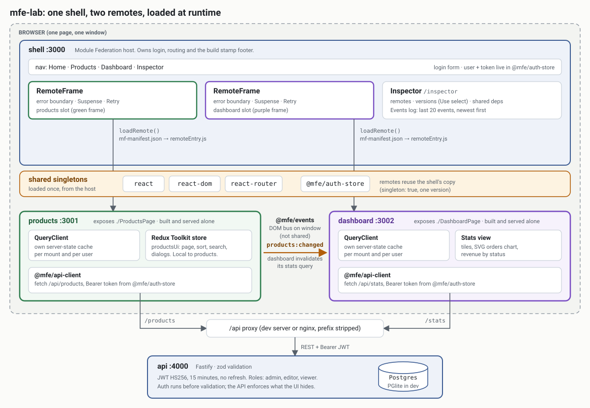
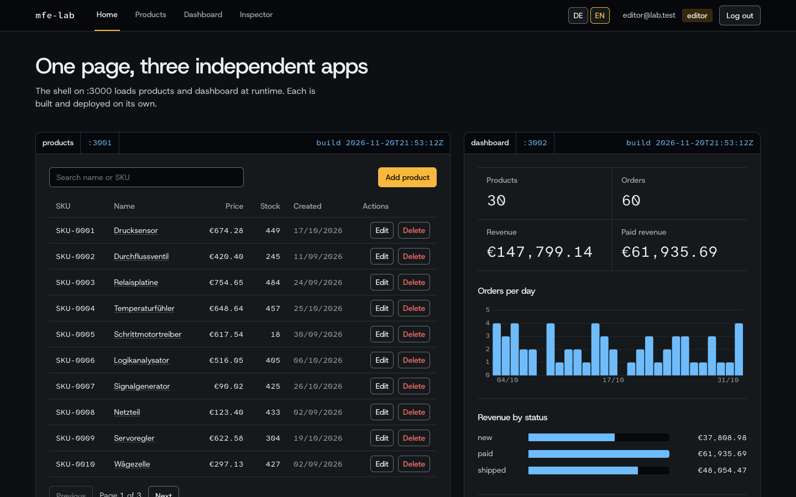
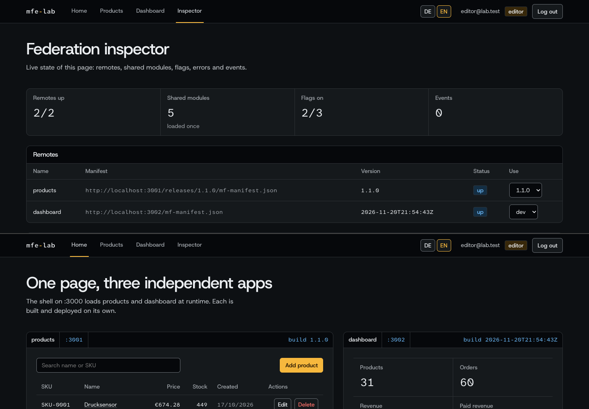
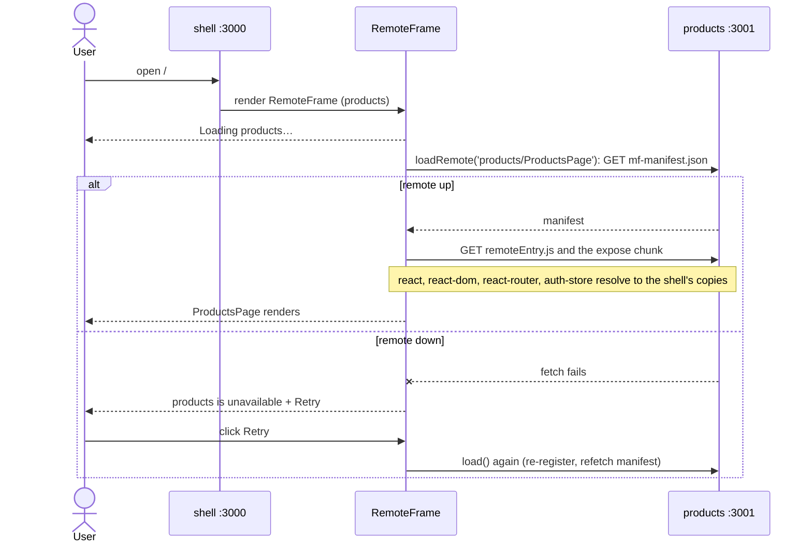
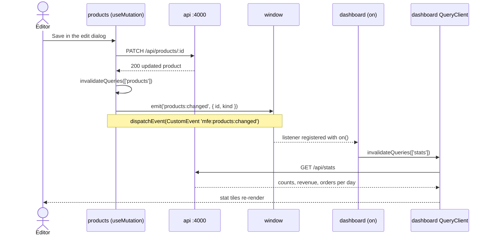
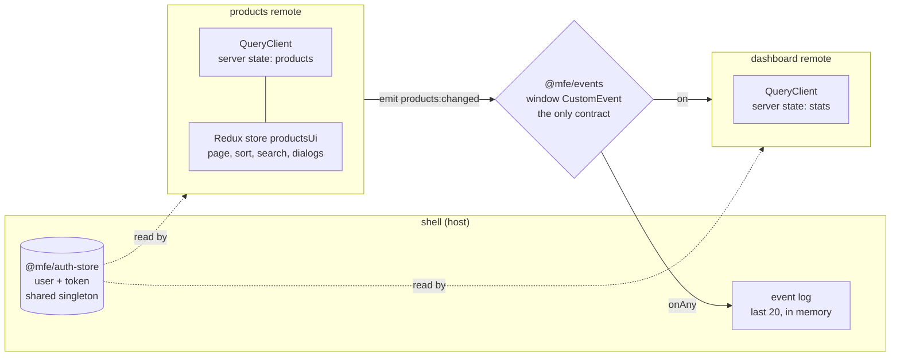

# mfe-lab

A learning lab for **Federated Micro Frontends**. One shell app loads two independently built and served remotes (products and dashboard) at runtime with Rspack Module Federation 2, shares React, React Router and the auth store as singletons, and keeps each remote's data in its own TanStack Query cache (plus a Redux Toolkit store local to products). The remotes sync through a small typed DOM event contract, and a Fastify + SQLite API gives them real auth and CRUD. The inspector page shows remotes, versions, shared dependencies and a live event log. Releases can be frozen and switched at runtime; Docker and Playwright e2e are included.



The brief is in [`docs/BRIEF.md`](docs/BRIEF.md), the task plan in [`docs/PLAN.md`](docs/PLAN.md), and the design decisions in [`docs/rfc/`](docs/rfc/). Why Module Federation and not Native Federation: [RFC 0003](docs/rfc/0003-native-federation-comparison.md).

## Quick start

Prerequisites: Node 26 (`nvm use`) and pnpm 12 (`packageManager` pins 12.21.0).

```bash
pnpm i
pnpm seed
pnpm dev
```

Then open <http://localhost:3000>. `pnpm dev` runs the shell (`:3000`), products (`:3001`), dashboard (`:3002`) and the API (`:4000`) in parallel.

Demo users (**demo-only**, never reuse the password): `admin@lab.test`, `editor@lab.test`, `viewer@lab.test`, all with password `lab12345`.

```bash
pnpm build   # apps/*/dist (remotes emit mf-manifest.json)
pnpm lint && pnpm typecheck && pnpm test
```

Remote manifest URLs are baked into the shell at build time; override with `MF_PRODUCTS_URL` / `MF_DASHBOARD_URL` (defaults `http://localhost:3001|3002/mf-manifest.json`). Package versions live in the `catalog:` of `pnpm-workspace.yaml`.

## Things to see

### 1. Login in the shell

Open the app and you are sent to `/login`. Sign in as any demo user; you land on the page you asked for. Only the shell has a login form.


### 2. Two remotes in one page

The home page mounts the products and dashboard remotes in labelled frames. Each frame shows its name, its port and the build stamp of the remote that served it. The shell footer shows its own stamp.



### 3. A dead remote does not take the page down

Stop the products dev server (or abort requests to `:3001` in the browser). The products frame shows "products is unavailable" with a Retry button, and the dashboard keeps working. Start the server again and click Retry: the frame loads without a page reload.


### 4. Remotes are built and versioned on their own

Restart or rebuild only one remote and reload the page: only its build stamp changes. The screenshot was taken after restarting just the dashboard dev server, so its stamp is newer than the products and shell stamps.


### 5. Shared dependencies are loaded once

`/inspector` (no login needed) lists the remotes with their live manifest version and up/down status, and the shared dependencies (`react`, `react-dom`, `react-router`, `@mfe/auth-store`) with their versions and a "loaded once" status read from the Module Federation share scope. The page also lists a few ways to break the setup on purpose.


### 6. The remotes know who is logged in

The products remote never logs in. It reads the user from the shared `@mfe/auth-store` singleton. Signed in as a viewer you only see the table; sign in as an editor or admin and the same remote shows the "Add product" button and the edit and delete actions. The API enforces the same roles.


### 7. Switch a remote to a frozen release

After `pnpm --filter @mfe/products release 1.0.0` and `1.1.0`, the inspector `Use` select for products lists `dev`, `1.0.0` and `1.1.0`. Pick `1.1.0` and the manifest URL changes to `/releases/1.1.0/mf-manifest.json`; Home then shows `build 1.1.0` in the products frame. The shell is not rebuilt (RFC 0004). The screenshot stacks the inspector and Home, because the selection lives in memory and cannot be shared between two page loads.



### 8. Events between remotes, live

The inspector has an `Events` table: every `@mfe/events` event with time, name and payload, newest first, last 20 only. This one was captured right after adding a product in the products frame.


### 9. Edit in one remote, the other updates

On Home, the dashboard `Products` tile reads 30. Add a product in the products frame and the tile moves to 31 with no reload and no shared cache between the two remotes; the new row is found by searching for its SKU.

| Before                                                                    | After                                                                                                 |
| ------------------------------------------------------------------------- | ----------------------------------------------------------------------------------------------------- |
|  |  |

## How it works

The shell (`:3000`) is a Module Federation host. At runtime it loads two independently built and served remotes, `products` (`:3001`) and `dashboard` (`:3002`), by fetching their `mf-manifest.json`, then `remoteEntry.js`. `react`, `react-dom`, `react-router` and `@mfe/auth-store` are singletons: loaded once from the shell, and the remotes reuse that copy. Every remote slot is wrapped in `RemoteFrame` (error boundary, Suspense, labelled frame, Retry), so a dead remote shows a fallback and the rest of the page keeps working. The remotes call the API on `:4000` through the shell's `/api` proxy. After the first render the shell prefetches both remotes (manifest, entry, expose chunks) on browser idle, so the first visit to a remote page loads from cache (RFC 0005).


Loading one remote, including the "remote down" path:



### Edit a product, the dashboard updates



A failed mutation (409, 500) emits nothing.

### Who owns which state



Rules: no remote reads another remote's store or cache; `@tanstack/react-query`, `@reduxjs/toolkit`, `react-redux` and `@mfe/events` are not in `federation.shared.ts`; only `react`, `react-dom`, `react-router` and `@mfe/auth-store` are shared.

### Login flow

The shell owns login. `@mfe/auth-store` is a federation singleton (see [RFC 0002](docs/rfc/0002-sharing-auth-state.md)), so the shell and both remotes read the same user and token. Guarded routes (`/`, `/products`, `/dashboard`) redirect anonymous users to `/login?next=<path>`; after signing in you land back on the page you asked for. The nav shows `email · role` and a Log out button.

The token lives in memory only, so **a page reload logs you out** (accepted trade-off, RFC 0002). API calls go through `@mfe/api-client` to the relative `/api/...`; each dev server proxies `/api` to `http://localhost:4000` (prefix stripped), so there is no CORS setup.

### Products remote

`apps/products` exposes `./ProductsPage` (no props): a table with search (300 ms debounce), sortable columns, pagination (10 per page), an add/edit dialog and a delete confirmation, all through `@mfe/api-client`. Admin and editor see the write actions; viewers only read. Validation lives in `apps/products/src/productForm.ts` (price is entered in dollars, stored as cents).

It also runs on its own: `pnpm --filter @mfe/products dev` serves it on `:3001` with a "Standalone dev" bar that signs in as the admin, editor or viewer demo account (the bar is not part of the exposed module, so the shell never shows it).

### Dashboard remote

`apps/dashboard` exposes `./DashboardPage` (no props): stat tiles (products, orders, revenue, paid revenue), an orders-per-day column chart in plain SVG, and revenue by status as bars. All data comes from `GET /stats` through `@mfe/api-client`. Days with no orders are filled with 0 so the time axis is honest. Each column has a hover and keyboard-focus tooltip, and a "Show data table" view lists the same numbers. Chart geometry and tick rules are in `apps/dashboard/src/stats.ts`.

It also runs on its own: `pnpm --filter @mfe/dashboard dev` serves it on `:3002` with the same "Standalone dev" bar as products (the bar is not part of the exposed module).

### Inspector and build stamps

Every build gets a stamp: `MF_BUILD_VERSION` if set, else the UTC time (`YYYY-MM-DDTHH:MM:SSZ`). It is baked in as `__BUILD_VERSION__`, written to `mf-manifest.json` (`metaData.buildInfo.buildVersion`), exported as `buildVersion` by both exposed pages, and shown in each remote frame and in the shell footer. Rebuild one remote and its stamp changes while the shell's stays. `/inspector` (no login) lists the remotes with their live manifest version and up/down status (polled every 5 s) and the shared dependencies read from the runtime's share scope.

## Data between remotes

Server state: products and dashboard each fetch through their own TanStack Query client, created per page mount and per user, bundled in each remote and never shared. After a user change the page refetches, so one user's rows are not shown to the next.

UI state: the products page keeps page, sort, order, search and open dialogs in a Redux Toolkit slice `productsUi`, in a store created per mount (`makeStore()`), local to products.

Between remotes: `@mfe/events` wraps `window` `CustomEvent`, so each remote may bundle its own copy and they still talk. The contract is the `EventMap` type in `packages/events/src/index.ts`; it has `products:changed` with `{ id, kind: 'created' | 'updated' | 'deleted' }` and `flags:changed` with `{ name, enabled }`. `emit` with an unknown name is a TypeScript error. Products emits it after a successful create, update or delete; the dashboard calls `invalidateQueries({ queryKey: ['stats'] })`. The shell subscribes with `onAny` and keeps the last 20 events for the inspector. Details and rejected alternatives: [RFC 0006](docs/rfc/0006-data-between-remotes.md).

## Nested routes

The shell mounts the products remote at `/products/*` and knows nothing about what is inside. The remote's second expose, `./ProductsApp`, has its own `<Routes>`: the list at `/products` and a detail page at `/products/:id`, linked with relative paths (`to="5"`, `to=".."`). It works because `react-router` is a shared singleton: the remote sees the shell's router, so the URL and the back button stay in sync. List page, sort and search survive going to a detail page and back. On Home the table uses `ProductsPage`, which links to the absolute `/products/<id>`. Standalone, `localhost:3001/5` shows the detail page. A cold load of `/products/5` works because the dev server and nginx fall back to `index.html` (you log in first, since a reload clears the token). Details: [RFC 0007](docs/rfc/0007-routing-inside-remotes.md).

## Versioned remotes

A remote can be frozen into a release and the shell can switch to it at runtime, using only manifest URLs (RFC 0004).

1. `pnpm --filter @mfe/products release 1.0.0` builds into `apps/products/releases/1.0.0/` and writes `releases/index.json` (gitignored; `dashboard` works the same).
2. Change a visible string in `apps/products/src/ProductsPage.tsx`.
3. `pnpm --filter @mfe/products release 1.1.0`.
4. With `pnpm dev` running, open `/inspector`, pick `1.0.0`, `1.1.0` or `dev` in the `Use` column for products, then open Home: the frame shows `build 1.1.0` and the change.

The selection lives in memory only: a reload goes back to `dev`. To clean up, delete `apps/products/releases`.

## Feature flags

Flags live in the API (`GET /flags`, admin-only `PATCH /flags/:name`). Each remote reads them through `useFlag(name, fallback)` with its own query client; the fallback applies while loading, on error and when signed out, so a remote still works standalone. A toggle emits `flags:changed` and mounted remotes refetch. Seeded flags: `dashboard.revenue` (hides Revenue by status), `products.detailPage` (names become plain text), `products.crash` (ProductsPage throws, so the shell frame shows its error fallback). Details: [RFC 0009](docs/rfc/0009-feature-flags.md).

Demo: sign in as `admin@lab.test`, open `/inspector`, uncheck `dashboard.revenue`, go Home: the Revenue by status section is gone. Check it again to bring it back. Turn on `products.crash` to see the Products frame fail while the rest of the page keeps working (Retry keeps failing until you turn it off). Viewers and editors see the checkboxes disabled.

## Error tracking

Errors are reported to the API with the remote and its build. `RemoteFrame` reports render and load failures (`report` prop, passed by the shell); `@mfe/telemetry` installs `window` handlers in the shell (`shell`), in each remote (`products`, `dashboard`) and a catch-all (`unknown`). Reports use `sendBeacon`, never throw, and the same message from the same remote is sent once per 5 s. Known limit: cross-origin `Script error.` has no filename or stack, so it lands in `unknown` (RFC 0010).

Demo: sign in as `admin@lab.test`, open `/inspector`, click `Clear` in the Errors section and check `products.crash` in Flags. Go Home: the products frame shows `products is unavailable`, the dashboard still renders. Back in the inspector click `Refresh`: a row with Remote `products` and Kind `render` appears, with the count `products: 1` above. Uncheck `products.crash` and click `Clear` to finish. Only admins see the section.

## Design system versions

`@mfe/ui` (`Button`, `Table`, `Field`) is shared with `singleton: false` and `requiredVersion: '^1.0.0'`, so each remote may use its own compatible version (RFC 0008). Styles use `--ds1-*` tokens and `ds1-*` classes: a breaking change means a major bump and a new prefix. See `packages/ui/CHANGELOG.md`.

Walkthrough (edit nothing you commit; revert at the end):

1. `pnpm --filter @mfe/products release 1.0.0-ds` freezes products with `@mfe/ui` 1.0.0.
2. **Compatible upgrade.** Set `"version": "1.1.0"` in `packages/ui/package.json` and run `pnpm dev`. In `/inspector`, pick `1.0.0-ds` for products and open Home. The Shared table still lists one `@mfe/ui` (1.1.0, loaded once): the old release asks for `^1.0.0`, the shell already provides 1.1.0, so the release reuses it. One copy, no duplicate bytes.
3. **Breaking upgrade.** Set the version to `2.0.0` and the `@mfe/ui` `requiredVersion` in `federation.shared.ts` to `^2.0.0`, restart `pnpm dev` and repeat. Now the table lists `1.0.0, 2.0.0`, `loaded 2 times`: the old release cannot use 2.x, so it loads its own bundled 1.0.0 next to the shell's 2.0.0. A real 2.0.0 would also move to the `ds2-` prefix, so the two copies cannot restyle each other.

Clean up with `git checkout -- packages/ui/package.json federation.shared.ts` and `rm -rf apps/products/releases`.

## Testing

- **Unit and component (black-box):** `pnpm test` runs Vitest. API tests use Fastify `inject` with in-memory SQLite; frontend tests use Testing Library. Tests are written from the task contract in `docs/PLAN.md`, not from the implementation.
- **E2E:** `pnpm e2e` runs one Playwright suite in `e2e/` against the dev servers in headless Chromium.
- **E2E on Docker images:** `pnpm e2e:docker` runs the same specs against the compose stack.

```bash
pnpm exec playwright install chromium   # once
pnpm e2e
pnpm e2e:docker
```

Playwright starts the API (after seeding), products, dashboard and shell itself. Locally it reuses servers that are already running (for example from `pnpm dev`) and does not stop them; in CI (`CI` set) it always starts its own. The suite covers login, both remotes rendering, the shared login (a viewer cannot see "Add product", an editor can), the inspector, and the remote-down fallback, which is simulated by aborting requests to `:3001`. Before the tests, `e2e/global-setup.ts` freezes two products releases, `0.0.1-e2e` and `0.0.2-e2e`, for the version-switching spec; `e2e/global-teardown.ts` deletes them and their `releases/index.json` entries. `pnpm e2e:docker` runs the compose stack (`docker compose up --build`, which Playwright stops afterwards; local only, `act` cannot run Docker). It skips the release fixtures and `E-versions`, because nginx serves no `releases/`. The containers are stopped, not removed; `docker compose down -v` removes them and the DB volume, and is the cleanup after an aborted run. Reports and traces go to `playwright-report/` and `test-results/` (gitignored).

## Docker

```bash
docker compose up --build -d   # shell :3000, products :3001, dashboard :3002
docker compose down -v         # stop and drop the DB volume
```

One `Dockerfile`, three targets: `build` (install and build all apps), `api` (production deps only, seeds on start, then `node src/server.ts`) and `web` (nginx with build arg `APP`). nginx falls back to `index.html`, proxies `/api/` to the API with the prefix stripped, sends `Access-Control-Allow-Origin: *` and `no-store` for `mf-manifest.json` and `remoteEntry.js`. The API listens on `HOST` (default `127.0.0.1`, compose sets `0.0.0.0`) and is not published to the host. The compose `JWT_SECRET` is demo-only. Manifest URLs stay `localhost:3001/3002`, so this is a local setup. CI does not cover it: `act` runs inside Docker.

## API

SQLite file `apps/api/data/app.db` (gitignored; override with `DB_PATH`, relative paths resolve against `apps/api/`). Migrations in `apps/api/migrations/*.sql` run on start, tracked by `PRAGMA user_version`.

```bash
pnpm seed         # seed if empty, otherwise prints "already seeded"
pnpm seed:reset   # wipe and reseed (3 users, 30 products, 60 orders)
pnpm --filter @mfe/api dev   # http://127.0.0.1:4000/health
```

Demo users (**demo-only credentials, never reuse**): `admin@lab.test`, `editor@lab.test`, `viewer@lab.test`, all with password `lab12345`. Passwords are hashed with scrypt (`node:crypto`), no extra dependency.

### Auth

- `POST /auth/login` with `{ "email", "password" }` returns `{ token, user }`. Wrong password and unknown email give the same `401 invalid_credentials`; a bad body gives `400 invalid_body`.
- `GET /auth/me` with `Authorization: Bearer <token>` returns the current user (read from the DB, so a deleted user gets `401`).
- Tokens are HS256 JWTs valid for **15 minutes**. There are no refresh tokens by design: log in again (RFC 0002).
- Routes are protected with `preHandler: app.authenticate` or `app.requireRole('admin', 'editor')` (`401 unauthorized`, `403 forbidden`).
- `JWT_SECRET` env sets the signing secret (see `.env.example`, **demo-only**). If unset outside production, the API uses an insecure dev secret and logs a warning; in production a missing secret is a startup error.

### Endpoints

All routes except `GET /health`, `POST /auth/login`, `POST /errors` and `/docs*` need `Authorization: Bearer <token>` (auth runs before validation, so no token is always `401`). Errors are always `{ "error": "<code>" }`: `invalid_body` / `invalid_query` / `invalid_params` (400), `unauthorized` (401), `forbidden` (403), `not_found` (404), `conflict` (409), `internal` (500).

| Route                                   | Roles allowed | Notes                                                                                                          |
| --------------------------------------- | ------------- | -------------------------------------------------------------------------------------------------------------- |
| `GET /products`                         | any           | `?page&limit&sort&order&q`; returns `{ items, total, page, limit }`; `q` matches name or sku, case-insensitive |
| `GET /products/:id`                     | any           |                                                                                                                |
| `POST /products`, `PATCH /products/:id` | admin, editor | duplicate sku gives `409`                                                                                      |
| `DELETE /products/:id`                  | admin, editor | `409` if the product has orders                                                                                |
| `GET /orders`                           | any           | `?page&limit&status`; newest first                                                                             |
| `POST /orders`, `PATCH /orders/:id`     | admin         | create sets status `new`; PATCH sets `status`                                                                  |
| `GET /stats`                            | any           | counts, revenue by status, orders per day (UTC)                                                                |
| `GET /flags`                            | any           | `{ name, enabled, description }[]` sorted by name                                                              |
| `PATCH /flags/:name`                    | admin         | body `{ enabled }`; unknown name gives `404`                                                                   |
| `POST /errors`                          | none          | error report from a browser; `message` cut to 500, `stack` to 4000; keeps the newest 1000 rows                 |
| `GET /errors`                           | admin         | `?remote`; newest 50                                                                                           |
| `GET /errors/summary`                   | admin         | `{ remote, count }[]`                                                                                          |
| `DELETE /errors`                        | admin         | returns `204`                                                                                                  |

Pagination defaults to `page=1&limit=20` (max `limit` 100); `sort` is one of `id, sku, name, price_cents, stock, created_at`.

Interactive OpenAPI docs: <http://localhost:4000/docs> (spec at `/docs/json`; both public).

## RFCs

| #    | Title                                                                                 | Status   | Decision                                                                                                                         |
| ---- | ------------------------------------------------------------------------------------- | -------- | -------------------------------------------------------------------------------------------------------------------------------- |
| 0001 | [Module Federation for the frontend](docs/rfc/0001-module-federation-for-frontend.md) | Accepted | One shell host and two remotes, built and served independently, joined at runtime with Rspack and `@module-federation/enhanced`. |
| 0002 | [Sharing auth state](docs/rfc/0002-sharing-auth-state.md)                             | Accepted | The shell owns login; remotes read user and token from the `@mfe/auth-store` singleton; the token stays in memory.               |
| 0003 | [Native Federation comparison](docs/rfc/0003-native-federation-comparison.md)         | Accepted | Stay on Module Federation 2; Native Federation would replace working code for little gain.                                       |
| 0004 | [Versioned remotes](docs/rfc/0004-versioned-remotes.md)                               | Accepted | Freeze a remote into a static release; the shell switches versions by changing only the manifest URL.                            |
| 0005 | [Prefetch remotes on idle](docs/rfc/0005-prefetch-remotes.md)                         | Accepted | After first render the shell preloads both remotes on idle; measured 1201 to 823 ms on Fast 4G.                                  |
| 0006 | [Data between remotes](docs/rfc/0006-data-between-remotes.md)                         | Accepted | One TanStack Query client per remote, Redux Toolkit local to products, typed `window` events between remotes; nothing shared.    |
| 0007 | [Routing inside remotes](docs/rfc/0007-routing-inside-remotes.md)                     | Accepted | The shell mounts a remote at `<name>/*`; the remote owns the subtree with relative links, on the shared router.                  |
| 0008 | [Design system versioning](docs/rfc/0008-design-system-versioning.md)                 | Accepted | `@mfe/ui` is a non-singleton semver share; CSS carries a major prefix (`ds1-`), so two versions can coexist.                     |
| 0009 | [Feature flags](docs/rfc/0009-feature-flags.md)                                       | Accepted | Flags live in the API; each remote reads them with its own query client; `flags:changed` refreshes them without a reload.        |
| 0010 | [Error tracking per remote](docs/rfc/0010-error-tracking.md)                          | Accepted | Frames and `window` handlers report to the API with remote and build; admins read them in the inspector.                         |

## Run CI locally

GitHub Actions minutes are unavailable, so run CI with [act](https://github.com/nektos/act) before any push or merge. Run it from a fresh clone of the committed branch (a worktree's `.git` points to a host path that does not exist in the container, and the clone tests only committed state, like real CI):

```bash
d=$(mktemp -d) && git clone -q -b <branch> "$PWD" "$d" && (cd "$d" && act pull_request -P ubuntu-latest=catthehacker/ubuntu:act-latest); rm -rf "$d"
```

## Dependencies

Dependabot (`.github/dependabot.yml`) opens weekly grouped PRs for npm and GitHub Actions. GitHub Actions minutes are unavailable, so CI does not run on GitHub. Check each Dependabot PR with local `act` from a fresh clone before merging (see "Run CI locally").
