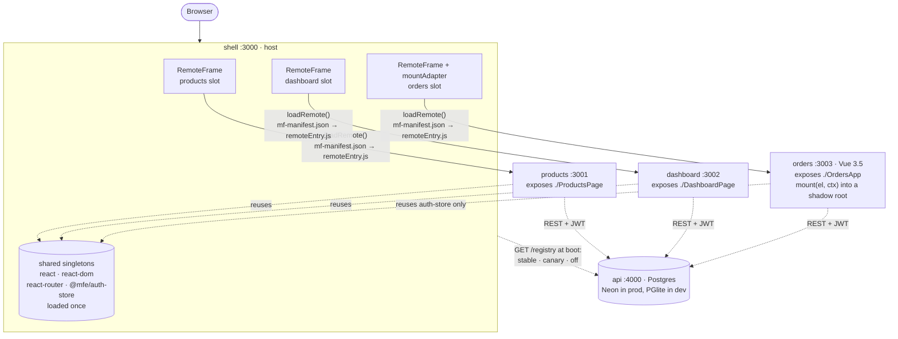
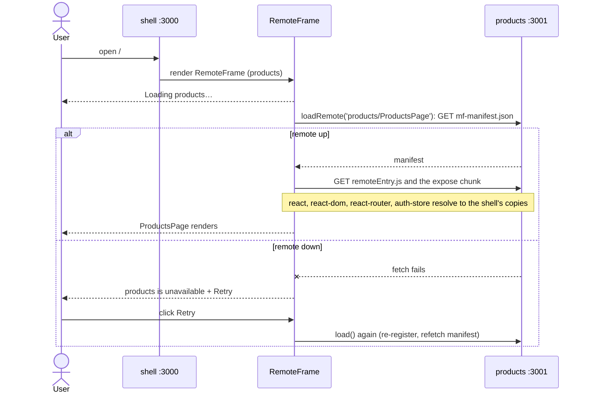
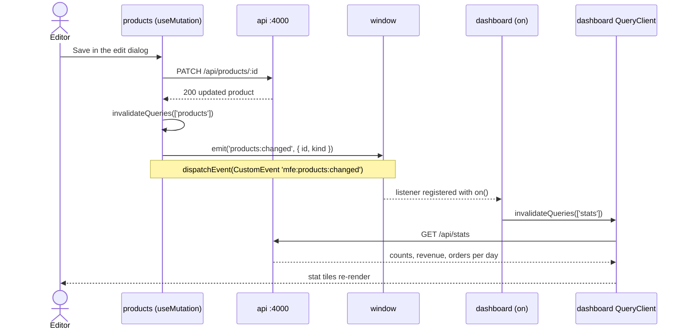
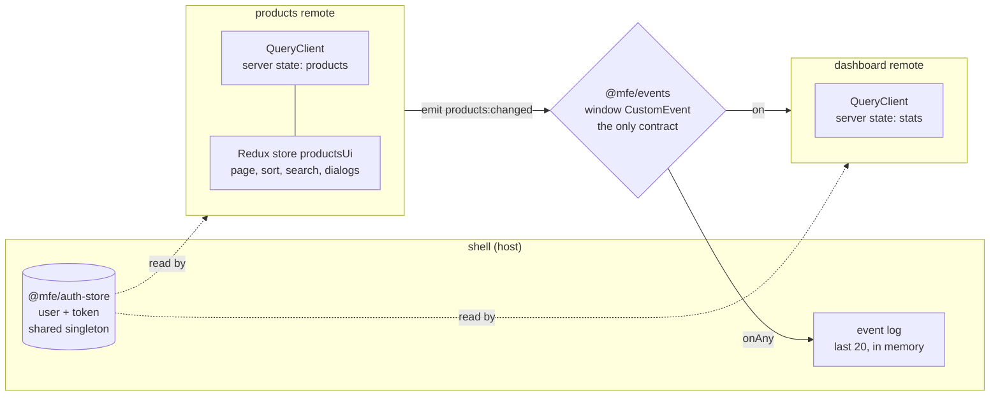

# How it works

The shell (`:3000`) is a Module Federation host. At runtime it loads three independently built and served remotes, `products` (`:3001`), `dashboard` (`:3002`) and `orders` (`:3003`, Vue), by fetching their `mf-manifest.json`, then `remoteEntry.js`. `react`, `react-dom`, `react-router` and `@mfe/auth-store` are singletons: loaded once from the shell, and the remotes reuse that copy (`orders` uses only the framework-free `@mfe/auth-store`). Every remote slot is wrapped in `RemoteFrame` (error boundary, Suspense, labelled frame, Retry), so a dead remote shows a fallback and the rest of the page keeps working. The remotes call the API on `:4000` through the shell's `/api` proxy. After the first render the shell prefetches the enabled remotes (manifest, entry, expose chunks) on browser idle, so the first visit to a remote page loads from cache (RFC 0005).

Loading one remote, including the "remote down" path:

## Edit a product, the dashboard updates

A failed mutation (409, 500) emits nothing.

## Who owns which state

Rules: no remote reads another remote's store or cache; `@tanstack/react-query`, `@reduxjs/toolkit`, `react-redux` and `@mfe/events` are not in `federation.shared.ts`; only `react`, `react-dom`, `react-router` and `@mfe/auth-store` are shared.

## Login flow

The shell owns login. `@mfe/auth-store` is a federation singleton (see [RFC 0002](rfc/0002-sharing-auth-state.md)), so the shell and all three remotes read the same user and token. Guarded routes (`/`, `/products`, `/dashboard`, `/orders`) redirect anonymous users to `/login?next=<path>`; after signing in you land back on the page you asked for. The nav shows the email, a role chip and a Log out button.

The token lives in memory only, so **a page reload logs you out** (accepted trade-off, RFC 0002). API calls go through `@mfe/api-client` to the relative `/api/...`; each dev server proxies `/api` to `http://localhost:4000` (prefix stripped), so there is no CORS setup.

## Products remote

`apps/products` exposes `./ProductsPage` (no props): a table with search (300 ms debounce), sortable columns, pagination (10 per page), an add/edit dialog and a delete confirmation, all through `@mfe/api-client`. Admin and editor see the write actions; viewers only read. Validation lives in `apps/products/src/productForm.ts` (price is entered in dollars, stored as cents).

It also runs on its own: `pnpm --filter @mfe/products dev` serves it on `:3001` with a "Standalone dev" bar that signs in as the admin, editor or viewer demo account (the bar is not part of the exposed module, so the shell never shows it).

## Orders remote (Vue, `mount` kind)

`apps/orders` exposes `./OrdersApp`, a `mount(el, ctx)` module (RFC 0016), not a React component. The shell adapter `mountAdapter` (`apps/shell/src/MountAdapter.tsx`) turns it into a page module for `RemoteFrame`, so the label, build stamp, Retry and error reports work as for the React remotes. `mount` attaches an open shadow root to the host element, injects its CSS as a `<style>` inside it and mounts the Vue app there. The lab's global CSS does not reach in; `--ds1-*` tokens, fonts and inherited properties do. It follows `locale:changed` itself (no remount), refetches on `products:changed`, and reads the same token as the React remotes through the framework-free `@mfe/auth-store`. The React hook is `@mfe/auth-store/react`. `GET /orders` has no product names, so the remote joins them from `GET /products`. It runs standalone on `:3003` with a sign-in bar and has no versioned releases.

## Dashboard remote

`apps/dashboard` exposes `./DashboardPage` (no props): stat tiles (products, orders, revenue, paid revenue), an orders-per-day column chart in plain SVG, and revenue by status as bars. All data comes from `GET /stats` through `@mfe/api-client`. Days with no orders are filled with 0 so the time axis is honest. Each column has a hover and keyboard-focus tooltip, and a "Show data table" view lists the same numbers. Chart geometry and tick rules are in `apps/dashboard/src/stats.ts`.

It also runs on its own: `pnpm --filter @mfe/dashboard dev` serves it on `:3002` with the same "Standalone dev" bar as products (the bar is not part of the exposed module).

## Inspector and build stamps

Every build gets a stamp: `MF_BUILD_VERSION` if set, else the UTC time (`YYYY-MM-DDTHH:MM:SSZ`). It is baked in as `__BUILD_VERSION__`, written to `mf-manifest.json` (`metaData.buildInfo.buildVersion`), exported as `buildVersion` by all four exposed modules (`ProductsPage`, `ProductsApp`, `DashboardPage`, `OrdersApp`), and shown in each remote frame and in the shell footer. Rebuild one remote and its stamp changes while the shell's stays. `/inspector` (no login) lists the remotes with their live manifest version and up/down status (polled every 5 s) and the shared dependencies read from the runtime's share scope.

## Accessibility

One owner per concern ([RFC 0011](rfc/0011-accessibility-across-remotes.md)). The shell sets `document.title` per top-level route, moves focus to the page `h1` after each client-side navigation (not on first load), renders the skip link (first tab stop, targets `main#main`) and one visually hidden `role="status"` live region. It shows one `h1` per page; `RemoteFrame` names each remote with an `h2`, and remote headings start at `h3`. A remote sets the title below its own route (`ProductDetail`) and announces by emitting `a11y:announce` `{ message }`; the shell writes it into the live region and re-announces an identical message by clearing the region first. A standalone remote has no listener, so nothing is announced there. `Table` with a `label` is a focusable scroll region. `eslint-plugin-jsx-a11y` checks the source, and `@axe-core/playwright` checks the running pages in e2e.

## Language and formats

The shell owns the locale ([RFC 0012](rfc/0012-locale-across-remotes.md)). Before the first render it sets `<html lang>` from `detectLocale()` (saved `localStorage['mfe-lab:locale']`, else a `de*` entry in `navigator.languages`, else `en`). The `DE` / `EN` switch in the top bar sets `lang`, saves the choice and emits `locale:changed` `{ locale }`. Every app reads the locale with `useLocale()` (the `lang` attribute, re-read on the event), so a switch re-renders all of them in place and a remote mounted later is already right. `orders` (a `mount` module) gets the locale at mount time as `ctx.locale` and then follows `locale:changed`. Each app owns `src/messages.ts` (`{ de, en }`, `en` typed as `typeof de`) behind its own `useT()`; a standalone remote sets `lang` in its bootstrap and has no switch. `@mfe/ui` exports `formatMoney`, `formatNumber`, `formatDate` and `formatTime` on `Intl` (`de-DE` or `en-GB`, EUR, 24-hour time). Prices are gross cents, shown with `inkl. 19 % MwSt.` on the detail page. Product names and flag descriptions are data and stay German. The footer links to `/impressum` and `/datenschutz`, public pages of the shell; the Impressum is a placeholder (`Max Mustermann`) and says so.

The exposed modules are a typed contract: `federation.contract.ts` lists them per remote, the remotes generate their `exposes` from it and the shell's `loadPage` only accepts names from it, so a wrong or removed expose fails `pnpm typecheck` ([RFC 0014](rfc/0014-typed-federation-contract.md)).

## Data between remotes

Server state: products and dashboard each fetch through their own TanStack Query client, created per page mount and per user, bundled in each remote and never shared. After a user change the page refetches, so one user's rows are not shown to the next.

UI state: the products page keeps page, sort, order, search and open dialogs in a Redux Toolkit slice `productsUi`, in a store created per mount (`makeStore()`), local to products.

Between remotes: `@mfe/events` wraps `window` `CustomEvent`, so each remote may bundle its own copy and they still talk. The contract is the `EventMap` type in `packages/events/src/index.ts`; it has `products:changed` with `{ id, kind: 'created' | 'updated' | 'deleted' }` `flags:changed` with `{ name, enabled }` and `a11y:announce` with `{ message }` and `locale:changed` with `{ locale }`. `emit` with an unknown name is a TypeScript error. Products emits it after a successful create, update or delete; the dashboard calls `invalidateQueries({ queryKey: ['stats'] })`. The shell subscribes with `onAny` and keeps the last 20 events for the inspector. Details and rejected alternatives: [RFC 0006](rfc/0006-data-between-remotes.md).
