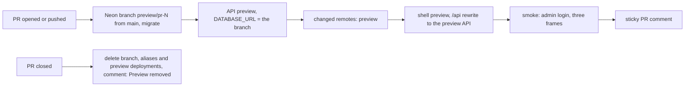

# Deploying to Vercel (prepared in T30, provisioned and deployed from Actions in T31)

Each app is its own Vercel project, built from the monorepo with its own root directory. Nothing here changes local dev, Docker or e2e.

The Swagger UI (`/docs`) is not served on Vercel: `@fastify/swagger-ui` pulls in an ESM-only dependency through `require()`, which the Vercel function loader rejects. The OpenAPI spec is still built; use `/docs` locally.

| Vercel project      | Root dir         | Production URL                         |
| ------------------- | ---------------- | -------------------------------------- |
| `mfe-lab` (shell)   | `apps/shell`     | `https://mfe-lab.vercel.app`           |
| `mfe-lab-products`  | `apps/products`  | `https://mfe-lab-products.vercel.app`  |
| `mfe-lab-dashboard` | `apps/dashboard` | `https://mfe-lab-dashboard.vercel.app` |
| `mfe-lab-orders`    | `apps/orders`    | `https://mfe-lab-orders.vercel.app`    |
| `mfe-lab-api`       | `apps/api`       | `https://mfe-lab-api.vercel.app`       |

## One place for URLs

`deploy/urls.json` holds the five URLs. `node scripts/vercel-config.ts` generates the five `apps/*/vercel.json` from it (the generated files are committed; a test checks they are up to date). If a `*.vercel.app` name is taken, edit `urls.json` and rerun the script.

## Static apps (shell, products, dashboard, orders)

`vercel.json` follows `docker/nginx.conf.template`, with one difference: nginx is one template for every app and sends the same headers from each container (`Access-Control-Allow-Origin: *`, `nosniff`, the CSP and `Referrer-Policy` on every path, including the shell and the remotes), while on Vercel each project sends only what its role needs:

- `/api/:path*` is rewritten to the API project (prefix stripped), so the browser stays same-origin and needs no CORS for the API; then everything else falls back to `/index.html`.
- products, dashboard and orders send `Access-Control-Allow-Origin: *` on every path (the shell loads their manifests and chunks). The shell sends no CORS header on Vercel; nobody loads its files cross-origin.
- `/mf-manifest.json` and `/remoteEntry.js` are `no-store`.
- Security headers (T46). Remotes: `X-Content-Type-Options: nosniff` on every path. Shell, on every path: `X-Content-Type-Options: nosniff`, `Referrer-Policy: strict-origin-when-cross-origin` and this CSP (generated by `scripts/vercel-config.ts`; each remote origin is read from `MF_<APP>_URL` when set, so a preview shell lists its own preview remotes, else from `urls.json`): `default-src 'self'; script-src 'self' <remotes>; style-src 'self' 'unsafe-inline' <remotes>; connect-src 'self' <remotes>; img-src 'self' data:; font-src 'self'; frame-ancestors 'none'; base-uri 'self'; form-action 'self'`. `<remotes>` (the exact origins, no wildcard): `script-src` for `remoteEntry.js` and chunks, `style-src` for remote CSS, `connect-src` for manifest and release-index fetches. `'unsafe-inline'` in `style-src` is needed by React `style` props and the Vue remote's Shadow DOM `<style>`; scripts never get it. `docker/nginx.conf.template` sends the same headers with `http://localhost:3001-3003` as remote origins (and repeats nosniff in the `location` blocks, because nginx does not inherit `add_header` into a block that sets its own). Dev servers (`pnpm dev`) send no CSP: HMR needs `eval` and websockets. The API sets `X-Content-Type-Options: nosniff` on every response, `Cache-Control: no-store` on authenticated requests, and answers unknown routes with `404 { "error": "not_found" }`.
- `Cache-Control: public, max-age=31536000, immutable` only on content-hashed files (`<name>.<16 hex>.js`, `.css`, `<16 hex>.woff2`). `remoteEntry.js`, `mf-manifest.json` and `index.html` keep fixed names and are never immutable (RFC 0015).
- Install and build run from the root-dir project with `pnpm install --frozen-lockfile --filter @mfe/<app>...` and `pnpm build`; output is `dist`. Vercel needs "Include source files outside of the Root Directory" enabled (the default).
- The shell gets `MF_PRODUCTS_URL`, `MF_DASHBOARD_URL` and `MF_ORDERS_URL` at build time (exported by `deploy.yml` from `urls.json`; `vercel build` ignores `build.env`), pointing at the production remotes' `/mf-manifest.json`; the job fails if the build output contains `localhost:300`.

## API (Vercel Function)

- `pnpm build` in `apps/api` bundles `src/vercel.ts` with rolldown to `apps/api/api/index.js` (gitignored). Vercel does not resolve our `.ts` import specifiers, hence this one build step; local dev and Docker still run `.ts` directly.
- The deploy job runs `pnpm --filter @mfe/api build` before `vercel build`: Vercel detects `api/*` functions before `buildCommand` runs, so a bundle produced only by it is never seen and the API 404s; a guard step fails the job if `.vercel/output/functions` has no `.func`.
- `apps/api/public/` holds only `robots.txt` (disallow all) because Vercel needs a non-empty static output directory: with `framework: null` and a build command, an empty or missing `outputDirectory` fails the build (`STATIC_BUILD_NO_OUT_DIR` / `STATIC_BUILD_EMPTY_OUT_DIR`). It also keeps the API out of search indexes; the `api/` function is detected separately.
- `vercel.json` sets `framework: null` (no zero-config Fastify detection, which would pick `src/app.ts`) and rewrites every path to the function.
- The function builds one Fastify app per warm instance, never calls `listen()`, and never migrates (`migrate: false`). Migrations run in CI (see Deploy flow); `provision.yml` also seeds once.
- PGlite is imported dynamically only for `pglite:` URLs, so production never loads it. The `pg` pool has `max: 3` and a 10 s idle timeout; use Neon's pooled connection string.
- Node 26 (`engines.node` `26.x` in `apps/api/package.json`).

### Env (set by `provision.yml`, never committed)

| Project | Variable       | Value                                                          |
| ------- | -------------- | -------------------------------------------------------------- |
| api     | `DATABASE_URL` | Neon pooled connection string (updated if it changes)          |
| api     | `JWT_SECRET`   | random, 32 bytes, created once and never rotated by the script |
| api     | `CRON_SECRET`  | random, 32 bytes, created once and never rotated by the script |
| static  | none           | shell URLs come from `deploy.yml` at build time                |

All three are type `sensitive` and target **production only**. Previews get their own values at deploy time (see PR previews); a preview deployment has no `CRON_SECRET`, so cron is off there. The API function runs in `fra1`, next to the database (`aws-eu-central-1`).

### Daily demo reset

`crons` runs `GET /cron/reseed` at 03:00 UTC (Hobby allows daily). The route needs `Authorization: Bearer <CRON_SECRET>` (401 otherwise) and is a 404 when `CRON_SECRET` is unset, so dev and Docker never expose it. It runs `seed(db, { reset: true })`, which truncates and reseeds users, products and orders, resets the remote registry to stable and every flag to its default, and clears the error log, and returns `{ reseeded, users, products, orders }`. It is hidden from Swagger. Vercel runs crons on production deployments only.

## Not on Vercel

`releases/` (frozen remote versions, `pnpm release`) is not built on Vercel, same as in Docker, so the inspector offers only `dev`.

## Provision once

`.github/workflows/provision.yml` (manual, `workflow_dispatch`) runs `node scripts/provision.ts`, which uses the Vercel and Neon REST APIs with plain `fetch` and is idempotent:

- Neon: finds or creates the project `mfe-lab` (Postgres 17, `aws-eu-central-1`).
- Vercel: finds or creates a project per entry of `deploy/urls.json` (five) (`framework: null`, root dir `apps/<name>`, Node 26.x), then checks that each production domain is the `*.vercel.app` URL in `deploy/urls.json` and fails naming the actual domain if not.
- API env vars as above. `DATABASE_URL` is a sensitive value that cannot be read back, so its comment holds a short hash of the URI; the script rewrites it only when the hash differs.
- The Neon URI is stored with `sslmode=verify-full` (not `require`, which pg warns about); the first run after this change rewrites `DATABASE_URL` once.
- The workflow then migrates and seeds Neon and checks that the database has 3 users. The pooled URI is fetched inside the job and masked with `::add-mask::`.

The script logs only names, ids and created / exists / updated. Re-run it any time; a second run changes nothing.

`orders` is a Vue remote (RFC 0016). It deploys like the other remotes, but it has no `release` script, so it is not versioned from the inspector.

## Deploy flow

`.github/workflows/deploy.yml` runs when CI succeeds for a push to `main` (`workflow_run`), by a weekly catch-up (`schedule`, Mondays 04:17 UTC), or by hand (`workflow_dispatch`, input `apps`: `changed` or `all`). A manual run is accepted only from `refs/heads/main`; from any other ref `plan` fails with "deploy only runs from main". Nothing is deployed from pull requests.

1. `plan` checks out the commit CI ran on (`workflow_run.head_sha`; the default checkout would be the newest `main`), and lists the files changed since the **last successful production deploy**: `scripts/deploy-base.ts` asks the GitHub API for the newest successful `deploy.yml` run on `main` and takes its `head_sha`. `scripts/changed-apps.ts` maps the files to apps. With no such run, or when its SHA is not an ancestor of the commit, everything is deployed. A skipped or cancelled commit is therefore picked up by the next deploy, and so is a Dependabot merge that triggered none. The weekly catch-up run does the same when no deploy followed a dependency-only merge. A deploy run that fails (including `vitals`) does not advance the base, so the next one redeploys the same changes.
2. `api`: migrate Neon, then deploy.

   **Migrations are expand/contract.** The migration runs before the new API code is live, and for a moment the running (old) code talks to the new schema; a failed deploy leaves the new schema under the old code for good. So a migration must stay compatible with the code that is running: add columns as nullable or with a default, add tables, backfill; do not drop, rename or tighten (`NOT NULL`, new constraints) in the same change that stops using the old shape. Ship the code first, then contract in a later PR.

3. `products`, `dashboard` and `orders` in parallel.
4. `shell` last.
5. `smoke` checks the live URLs: shell `<title>`, `/api/health` 200, the products and orders manifests (200, CORS `*`, `no-store`), and `/cron/reseed` 401 without auth.
6. `vitals` runs `node scripts/vitals.ts` against the shell URL from `deploy/urls.json`: Chromium on Fast 4G and 4x CPU, 5 cold runs, median LCP, CLS and time-to-remotes against `perf-budget.json`. The table goes to the job summary; a median over budget fails the job. It runs only after a green `smoke`, and a failure does not roll the deploy back. Locally: `VITALS_URL=<base> pnpm vitals`.

Per app: `vercel link --yes --project <name>` (so no project id is stored), `vercel pull --yes --environment=production`, `vercel build --prod`, `vercel deploy --prebuilt --prod`. The CLI is pinned in `deploy.yml` (`VERCEL_CLI`) and runs with `pnpm dlx`. Jobs run under `concurrency: deploy` without cancelling.

### What gets deployed

| Changed path                                                                                                                                                                 | Apps     |
| ---------------------------------------------------------------------------------------------------------------------------------------------------------------------------- | -------- |
| `apps/<x>/**` (the API's migrations included)                                                                                                                                | `<x>`    |
| `packages/**`, `federation.shared.ts`, `pnpm-lock.yaml`, `pnpm-workspace.yaml`, root `package.json`, `deploy/**`, `scripts/vercel-config.ts`, `.github/workflows/deploy.yml` | all five |
| docs, tests, `e2e/`, the rest of `.github/**`                                                                                                                                | none     |

If two merges land while a deploy is running, the queue keeps only the newest pending run; its diff starts at the last successful deploy, so the skipped commit's changes are included. CI on `main` is never cancelled (`cancel-in-progress` only for pull requests), so a push run always finishes and triggers its deploy.

PR previews are a separate workflow, see below.

### Secrets (names only)

Repository secrets: `VERCEL_TOKEN`, `NEON_API_KEY`. `NEON_API_KEY` is passed only to the steps that call Neon. The Vercel GitHub app is not needed. Set them yourself with `gh secret set`; never paste values to an agent. The runtime secrets live only in the Vercel project env.

## PR previews

`.github/workflows/preview.yml` gives every same-repo PR a live copy of the lab (RFC 0018). It never touches production data or production deployments.

A preview is skipped when a PR changes no app: only docs, tests (`apps/*/test`, `*.test.*`, `*.spec.*`, `e2e`, `tests`) or CI files other than the preview pipeline. The Plan step decides with `previewNeeded` in `scripts/changed-apps.ts`; the Neon, migrate, deploy and smoke steps are skipped, the job succeeds and the comment says "Preview skipped". This saves the Vercel free plan's 100 deployments a day. PRs that touch the preview pipeline itself (`preview.yml`, `scripts/preview-*.ts`, `scripts/provision.ts`, `scripts/vercel-config.ts`) still get a real preview.

- `vercel build` and `vercel deploy --prebuilt` without `--prod`, in the existing projects, then `vercel alias set` to stable hosts: `mfe-lab-pr-<n>.vercel.app`, `mfe-lab-<app>-pr-<n>.vercel.app` (`scripts/preview-urls.ts`).
- The API gets `DATABASE_URL` (the PR's branch) and `JWT_SECRET` (random per run, masked) as runtime envs of that deployment only (`-e`), not project env vars. The production secrets target production only, and there is no `CRON_SECRET` in a preview. Every preview deployment is tagged `-m pr=<n>`.
- Before `vercel alias set`, `scripts/preview-guard.ts` reads `/health` of the raw API deployment URL and checks that its `db` is the PR branch's fingerprint and not production's. If it is not, the job fails and the alias is never set.
- Only the remotes the PR changed get a preview; the others stay on their production URLs from `deploy/urls.json`. The shell is built with those `MF_*_URL`, and `PREVIEW_API_URL=<preview api> node scripts/vercel-config.ts` regenerates the configs in the throwaway checkout so the shell's `/api` rewrite reaches the preview API. The browser stays same-origin, so there is no CORS.
- Smoke: `scripts/preview-smoke.ts` signs in as the demo admin and waits for the products, dashboard and orders frames.
- One sticky comment (marker `<!-- mfe-lab-preview -->`, `scripts/preview-comment.ts`) is edited on every push and set to "Preview removed" on close. Only a marker comment written by `github-actions[bot]` is edited; any other is ignored and a new one is created.
- Cleanup on close: every step runs with `if: always()`: delete the Neon branch, `vercel alias rm` the five hosts, `vercel remove` each deployment tagged with the PR (found through the Vercel API by the `pr` metadata; production deployments are never touched), then the comment. Neon branches are created with `expires_at` 14 days ahead and the date is pushed out on every sync, so a PR that never closes cleanly still loses its branch.
- Limits: forks and Dependabot PRs are skipped (no secrets); Neon free tier caps branches, and then the comment says "preview unavailable"; the preview has its own `JWT_SECRET`, but the demo logins are public; previews must be reachable without a Vercel login, so Vercel Authentication (deployment protection) is off on all five projects (owner decision, 2026-11-22) and preview links are public, like production.
- The job runs PR code with the deploy secrets, which is acceptable only because forks are skipped.

## Dependabot auto-merge

`dependabot-auto-merge.yml` uses an allowlist (`scripts/dependabot-merge.ts`, run from the base commit): auto-merge is enabled only when every updated dependency is a patch or a minor of a version at or above 1.0.0, the ecosystem is not `github_actions`, and every commit of the PR is authored by `dependabot[bot]`. Majors, 0.x minors and unknown types stay manual.

## Owner checklist

1. Create Vercel and Neon accounts (a Vercel team and a Neon organization are fine: `scripts/provision.ts` discovers them from the tokens and `deploy.yml` passes `--scope`; nothing is stored, and several teams or orgs fail with a listing).
2. `gh secret set VERCEL_TOKEN` and `gh secret set NEON_API_KEY`.
3. After merge: run `provision.yml`, then `deploy.yml` with `all`. (Since T48 the production secrets target production only; remove the `preview` target from `DATABASE_URL`, `JWT_SECRET` and `CRON_SECRET` on `mfe-lab-api` once, in the Vercel dashboard.)
