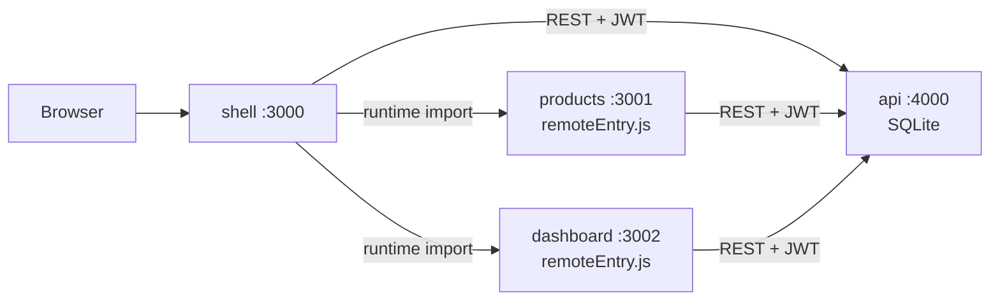

# RFC 0001: Module Federation for the frontend

- **Status:** Accepted
- **Author:** owner
- **Date:** 2026-11-18
- **Related:** `docs/BRIEF.md`, RFC 0002

## Summary

Split the UI into one **shell** (host) and two **remotes** (`products`, `dashboard`), each built and served independently. The shell loads remotes at runtime through Module Federation, using Rspack with `@module-federation/enhanced`.

## Motivation

This repo exists to demonstrate the pattern: independent build and deploy per UI slice, shared runtime dependencies loaded once, failure isolation. A monolith would hide all three.

## Goals / Non-goals

- Goal: remotes build and run without the shell; shell runs with a remote down.
- Goal: React, ReactDOM, router, auth store are singletons.
- Goal: boundaries visible in the UI (frame, label, version).
- Non-goal: production-grade versioning, CDN, SSR, independent teams' tooling.

## Proposal

- **Host:** `apps/shell`, `remotes: { products: 'products@http://localhost:3001/mf-manifest.json', dashboard: ... }`. Remote URLs come from env with local defaults, declared once in `remotes.ts`.
- **Remotes:** expose one page component each (`./ProductsPage`, `./DashboardPage`). Own `index.tsx` for standalone development.
- **Shared:** `react`, `react-dom`, `react-router-dom`, `@mfe/auth-store` with `singleton: true` and a `requiredVersion` from the root lockfile. One shared list, imported by all three Rspack configs.
- **Isolation:** every remote mounts inside `RemoteFrame` = error boundary + Suspense + visible frame. A failed `import()` renders a fallback with a retry button, never a blank page.
- **Contract:** the exposed module is the only public surface. Props: none for pages (they read auth from the shared store and router from the shared singleton). Adding props needs a new RFC.
- **Versioning (lab level):** each build writes `mf-manifest.json` with a build stamp; the inspector page reads it. No semver negotiation between remotes.

## Alternatives considered

| Option | Why not |
|---|---|
| Single SPA monolith | Hides the point of the lab. |
| iframes | Strong isolation but no shared state or deps, poor UX, nothing to learn about federation. |
| single-spa | Extra orchestration layer; Module Federation covers the need with less. |
| Native Federation / import maps | Good candidate for a later comparison RFC. |
| Vite + federation plugin | Less mature runtime and manifest tooling than Rspack today. |
| Webpack 5 | Works, slower; Rspack is config-compatible and faster. |

## Trade-offs and risks

- Version drift of shared singletons causes runtime warnings or two copies of React. Mitigation: one shared list, inspector shows loaded versions.
- Remote types are not shared automatically. Mitigation: `@module-federation/enhanced` type generation, or a local `remotes.d.ts` declared in the shell.
- More moving parts than a monolith for a small app. Accepted: that is the lesson.
- Debugging across three dev servers. Mitigation: single `pnpm dev`, fixed ports.

## Rollout

T4 (host + stubs), T6 and T7 (real remotes), T8 (inspector). See `docs/PLAN.md`.

## Open questions

- Should the shell prefetch remote entries on idle? Measure first.
