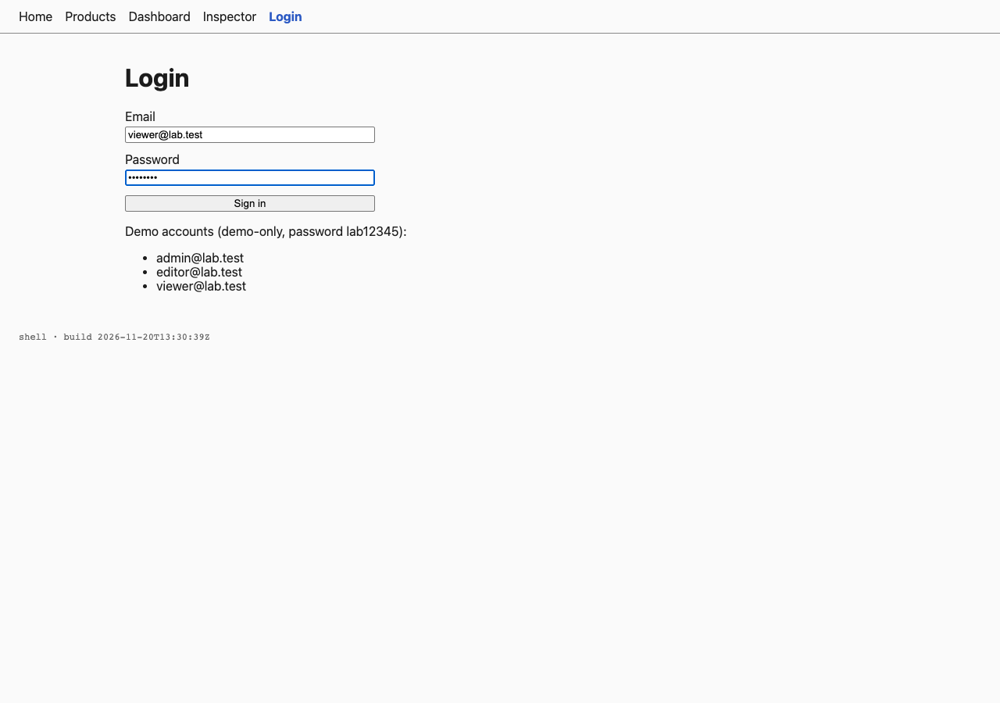
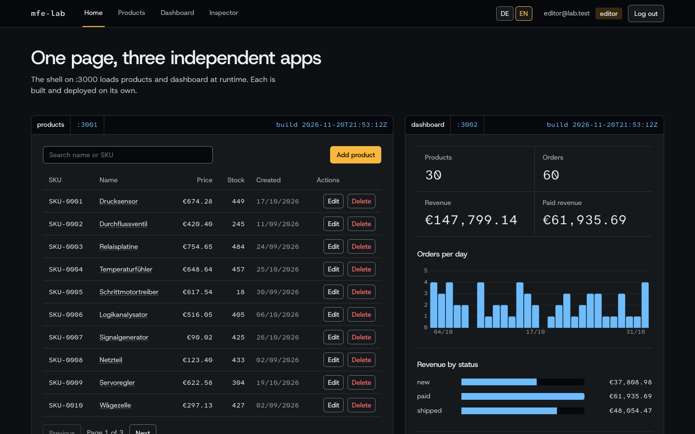
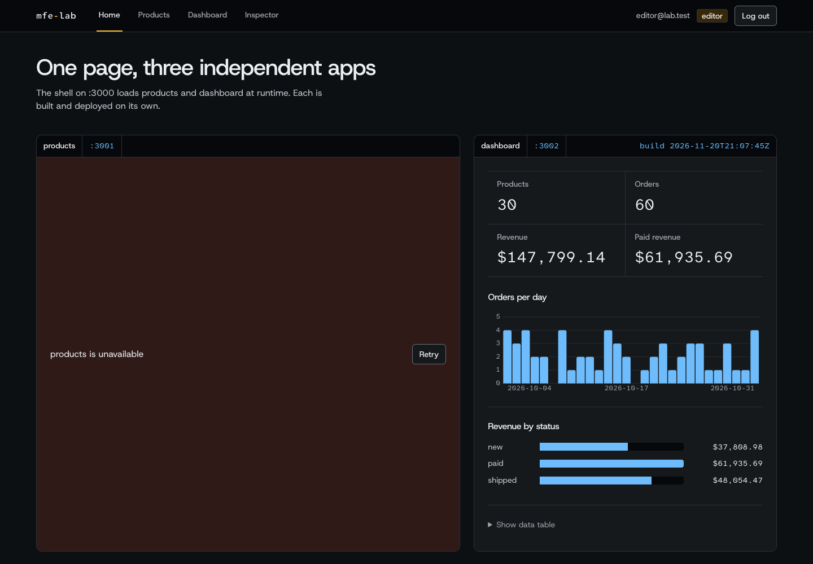
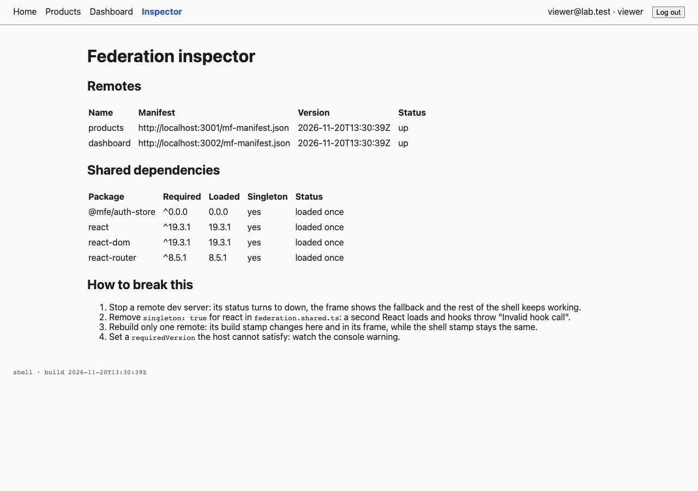
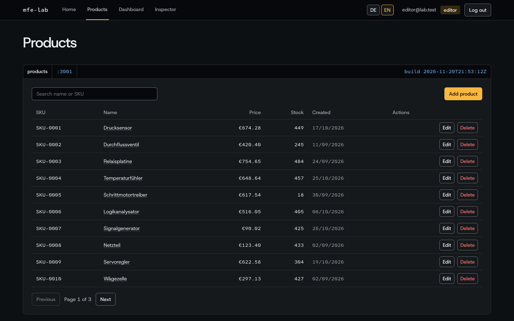
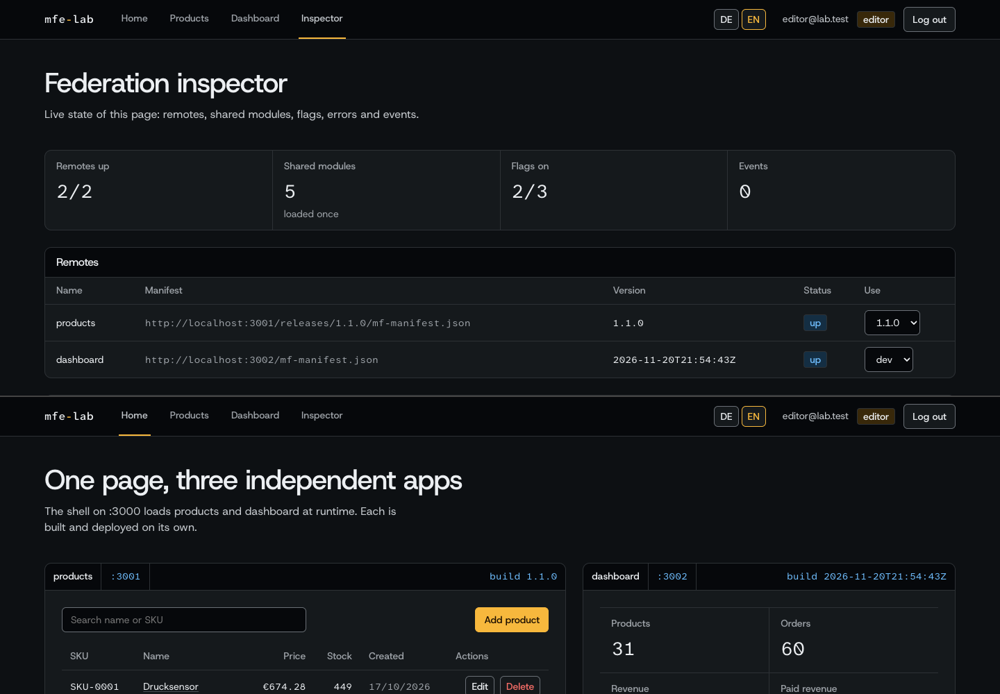
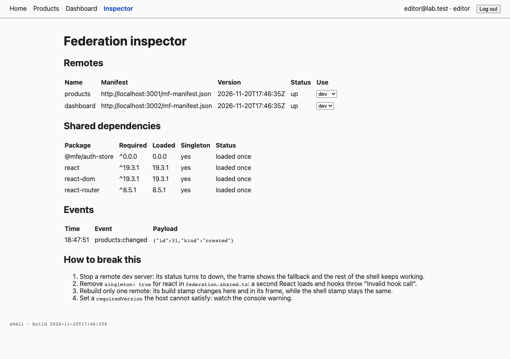
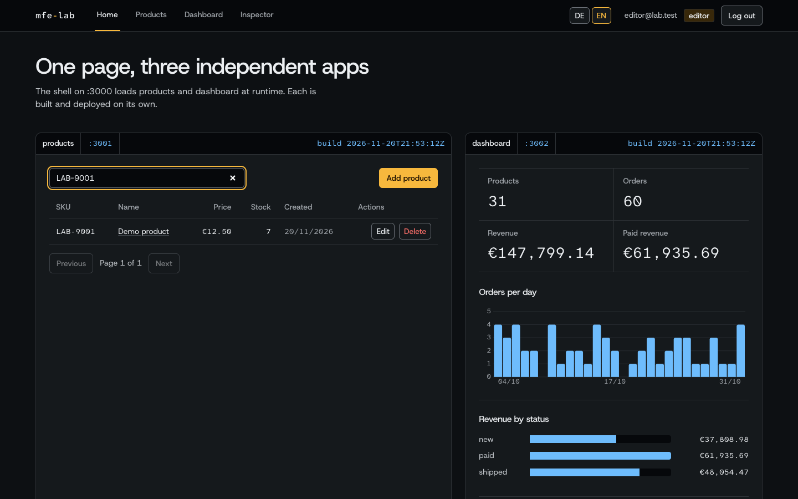

# Tour

What to look at in the running app, with screenshots, plus hands-on walkthroughs for each platform feature. Start the app with `pnpm i && pnpm seed && pnpm dev` and open <http://localhost:3000>.

## Things to see

### 1. Login in the shell

Open the app and you are sent to `/login`. Sign in as any demo user; you land on the page you asked for. Only the shell has a login form.

### 2. Two remotes in one page

The home page mounts the products and dashboard remotes in labelled frames. Each frame shows its name, its port and the build stamp of the remote that served it. The shell footer shows its own stamp.

### 3. A dead remote does not take the page down

Stop the products dev server (or abort requests to `:3001` in the browser). The products frame shows "products is unavailable" with a Retry button, and the dashboard keeps working. Start the server again and click Retry: the frame loads without a page reload.

### 4. Remotes are built and versioned on their own

Restart or rebuild only one remote and reload the page: only its build stamp changes. The screenshot was taken after restarting just the dashboard dev server, so its stamp is newer than the products and shell stamps.

### 5. Shared dependencies are loaded once

`/inspector` (no login needed) lists the remotes with their live manifest version and up/down status, and the shared dependencies (`react`, `react-dom`, `react-router`, `@mfe/auth-store`) with their versions and a "loaded once" status read from the Module Federation share scope. The page also lists a few ways to break the setup on purpose.

### 6. The remotes know who is logged in

The products remote never logs in. It reads the user from the shared `@mfe/auth-store` singleton. Signed in as a viewer you only see the table; sign in as an editor or admin and the same remote shows the "Add product" button and the edit and delete actions. The API enforces the same roles.

### 7. Switch a remote to a frozen release

After `pnpm --filter @mfe/products release 1.0.0` and `1.1.0`, the inspector `Use` select for products lists `dev`, `1.0.0` and `1.1.0`. Pick `1.1.0` and the manifest URL changes to `/releases/1.1.0/mf-manifest.json`; Home then shows `build 1.1.0` in the products frame. The shell is not rebuilt (RFC 0004). The screenshot stacks the inspector and Home, because the selection lives in memory and cannot be shared between two page loads.

### 8. Events between remotes, live

The inspector has an `Events` table: every `@mfe/events` event with time, name and payload, newest first, last 20 only. This one was captured right after adding a product in the products frame.

### 9. Edit in one remote, the other updates

On Home, the dashboard `Products` tile reads 30. Add a product in the products frame and the tile moves to 31 with no reload and no shared cache between the two remotes; the new row is found by searching for its SKU.

| Before                                                               | After                                                                                            |
| -------------------------------------------------------------------- | ------------------------------------------------------------------------------------------------ |
|  |  |

## Walkthroughs

### Nested routes

The shell mounts the products remote at `/products/*` and knows nothing about what is inside. The remote's second expose, `./ProductsApp`, has its own `<Routes>`: the list at `/products` and a detail page at `/products/:id`, linked with relative paths (`to="5"`, `to=".."`). It works because `react-router` is a shared singleton: the remote sees the shell's router, so the URL and the back button stay in sync. List page, sort and search survive going to a detail page and back. On Home the table uses `ProductsPage`, which links to the absolute `/products/<id>`. Standalone, `localhost:3001/5` shows the detail page. A cold load of `/products/5` works because the dev server and nginx fall back to `index.html` (you log in first, since a reload clears the token). Details: [RFC 0007](rfc/0007-routing-inside-remotes.md).

### Versioned remotes

A remote can be frozen into a release and the shell can switch to it at runtime, using only manifest URLs (RFC 0004).

1. `pnpm --filter @mfe/products release 1.0.0` builds into `apps/products/releases/1.0.0/` and writes `releases/index.json` (gitignored; `dashboard` works the same).
2. Change a visible string in `apps/products/src/ProductsPage.tsx`.
3. `pnpm --filter @mfe/products release 1.1.0`.
4. With `pnpm dev` running, open `/inspector`, pick `1.0.0`, `1.1.0` or `dev` in the `Use` column for products, then open Home: the frame shows `build 1.1.0` and the change.

The selection lives in memory only: a reload goes back to `dev`. To clean up, delete `apps/products/releases`.

### Feature flags

Flags live in the API (`GET /flags`, admin-only `PATCH /flags/:name`). Each remote reads them through `useFlag(name, fallback)` with its own query client; the fallback applies while loading, on error and when signed out, so a remote still works standalone. A toggle emits `flags:changed` and mounted remotes refetch. Seeded flags: `dashboard.revenue` (hides Revenue by status), `products.detailPage` (names become plain text), `products.crash` (ProductsPage throws, so the shell frame shows its error fallback). Details: [RFC 0009](rfc/0009-feature-flags.md).

Demo: sign in as `admin@lab.test`, open `/inspector`, uncheck `dashboard.revenue`, go Home: the Revenue by status section is gone. Check it again to bring it back. Turn on `products.crash` to see the Products frame fail while the rest of the page keeps working (Retry keeps failing until you turn it off). Viewers and editors see the checkboxes disabled.

### Error tracking

Errors are reported to the API with the remote and its build. `RemoteFrame` reports render and load failures (`report` prop, passed by the shell); `@mfe/telemetry` installs `window` handlers in the shell (`shell`), in each remote (`products`, `dashboard`) and a catch-all (`unknown`). Reports use `sendBeacon`, never throw, and the same message from the same remote is sent once per 5 s. Known limit: cross-origin `Script error.` has no filename or stack, so it lands in `unknown` (RFC 0010).

Demo: sign in as `admin@lab.test`, open `/inspector`, click `Clear` in the Errors section and check `products.crash` in Flags. Go Home: the products frame shows `products is unavailable`, the dashboard still renders. Back in the inspector click `Refresh`: a row with Remote `products` and Kind `render` appears, with the count `products: 1` above. Uncheck `products.crash` and click `Clear` to finish. Only admins see the section.

### Design system versions

`@mfe/ui` (`Button`, `Table`, `Field`) is shared with `singleton: false` and `requiredVersion: '^1.0.0'`, so each remote may use its own compatible version (RFC 0008). Styles use `--ds1-*` tokens and `ds1-*` classes: a breaking change means a major bump and a new prefix. See `packages/ui/CHANGELOG.md`.

Walkthrough (edit nothing you commit; revert at the end):

1. `pnpm --filter @mfe/products release 1.0.0-ds` freezes products with `@mfe/ui` 1.0.0.
2. **Compatible upgrade.** Set `"version": "1.1.0"` in `packages/ui/package.json` and run `pnpm dev`. In `/inspector`, pick `1.0.0-ds` for products and open Home. The Shared table still lists one `@mfe/ui` (1.1.0, loaded once): the old release asks for `^1.0.0`, the shell already provides 1.1.0, so the release reuses it. One copy, no duplicate bytes.
3. **Breaking upgrade.** Set the version to `2.0.0` and the `@mfe/ui` `requiredVersion` in `federation.shared.ts` to `^2.0.0`, restart `pnpm dev` and repeat. Now the table lists `1.0.0, 2.0.0`, `loaded 2 times`: the old release cannot use 2.x, so it loads its own bundled 1.0.0 next to the shell's 2.0.0. A real 2.0.0 would also move to the `ds2-` prefix, so the two copies cannot restyle each other.

Clean up with `git checkout -- packages/ui/package.json federation.shared.ts` and `rm -rf apps/products/releases`.
